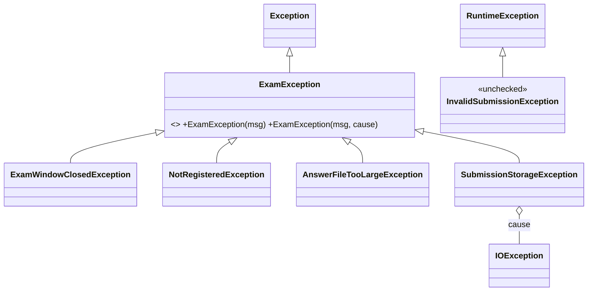

# Q2 – User-Defined Exceptions and Propagation in an Online Examination Portal (K4)

> Pair-work note: both the Student A and Student B parts were done by me (Nithish G), and they are labelled below.

## Shared group work – design and implementation (`portal/`)

| Layer | Class | Rule it checks | Throws |
|---|---|---|---|
| Controller | `SubmissionController.handle` | exam window still open | `ExamWindowClosedException`; also **catches everything** and builds the student message |
| Service | `SubmissionService.submit` | student registered for the course; arguments not blank | `NotRegisteredException`, `InvalidSubmissionException`; `throws ExamException` passes storage errors up |
| Storage | `SubmissionStorage.store` | file ≤ 500 KB; disk write succeeds | `AnswerFileTooLargeException`, `SubmissionStorageException` (wraps the `IOException`) |

Checked vs unchecked:

* All **rule violations a student can cause and the portal must answer** are checked subclasses of `ExamException`. The compiler then forces every layer to either handle them or declare them.
* `InvalidSubmissionException` (blank regNo) is **unchecked** (`RuntimeException`). It means a *caller bug*: the UI should never send a blank regNo, so forcing every method to declare it would only add noise.

`throw` is used in each layer, and `throws` on `store`, `submit` and `save`. **Chaining:** `new SubmissionStorageException("Could not store …", e)` keeps the `IOException` as the cause.

### Complete the Code – `complete/StorageDemo.java`

```java
// TODO 1
throw new SubmissionStorageException("Could not store " + fileName, e);
```

| | Output |
|---|---|
| Expected | `Saved answer01.pdf` / `Error: Could not store answer02.pdf` / `Cause: Disk quota exceeded` |
| **Actual** | `Saved answer01.pdf` / `Error: Could not store answer02.pdf` / `Cause: Disk quota exceeded` ✔ |

**What if the IOException were not passed to the constructor?** I ran this as an experiment (`complete_nocause/`, which passes `null` as the cause). The `Error:` line still prints, but `e.getCause()` returns `null`, so `e.getCause().getMessage()` throws:

```
Exception in thread "main" java.lang.NullPointerException: Cannot invoke "java.lang.Throwable.getMessage()"
because the return value of "ExamException.getCause()" is null
	at StorageDemo.main(StorageDemo.java:35)
```

The **Cause line is never printed**. Instead the program crashes with an NPE inside the error handler, and the real reason ("Disk quota exceeded") is gone.

## Student A – Exception Hierarchy and Propagation Design

### Class diagram



### Why each exception is checked or unchecked

| Exception | Kind | Reason |
|---|---|---|
| `ExamException` (base) | checked | Lets the controller catch "any portal rejection" in one clause; is the root for chaining constructors |
| `ExamWindowClosedException` | checked | An expected business outcome that must be shown to the student. Forgetting to handle it would leave the student with no answer |
| `NotRegisteredException` | checked | Same: a normal, recoverable rejection ("contact the exam cell") |
| `AnswerFileTooLargeException` | checked | The student can recover by compressing the file, so the caller should be forced to tell them |
| `SubmissionStorageException` | checked | Infrastructure failure the controller must turn into a "retry" message. Wraps `IOException` so upper layers need not know about files |
| `InvalidSubmissionException` | **unchecked** | A programming error (precondition violation). It should be fixed in code, not handled at runtime, so it does not belong in every `throws` clause |

### Propagation path of one exception (disk full)

```
Disk.write()                  throws IOException("No space left on device")
   │  (checked, caught immediately – storage is the only layer allowed to know about I/O)
   ▼
SubmissionStorage.store()     catch (IOException e) → throw new SubmissionStorageException("Could not store ans.pdf …", e)
   │  declared: throws SubmissionStorageException
   ▼
SubmissionService.submit()    does NOT catch – passes it on (declared: throws ExamException)
   │
   ▼
SubmissionController.handle() catch (SubmissionStorageException e) → log full chain, return polite message
   │
   ▼
Student sees: "REJECTED: Server could not save your answer. It has NOT been submitted; please retry. (ref 5674cd4d)"
```

### Where it is finally handled and what the student sees

It is handled **only in the controller**, the single layer that talks to the user. The student sees a clear, non-technical message saying that the answer was *not* saved and that they should retry, plus a reference code. Engineers see the full chain in the server log (`caused by: java.io.IOException: No space left on device (/exam-store)`), matched by that reference. The student never sees the path, the stack trace or `IOException`.

## Student B – Failure Scenarios and Chaining Evidence

### One scenario per exception – test table (real output)

| # | Scenario | Exception expected | Observed message to student | Pass |
|---|---|---|---|---|
| 1 | valid, in time, registered, 120 KB | none | `ACCEPTED: ans.pdf submitted.` | ✔ |
| 2 | submitted at 12:05, window closed 12:00 | `ExamWindowClosedException` (controller) | `REJECTED: Exam window closed at 12:00. Late submissions are not accepted.` | ✔ |
| 3 | 192511001 submits for CSA09 | `NotRegisteredException` (service) | `REJECTED: 192511001 is not registered for CSA09. Contact the exam cell.` | ✔ |
| 4 | 800 KB file | `AnswerFileTooLargeException` (storage) | `REJECTED: big.pdf is 800 KB; limit is 500 KB. Compress the file and resubmit.` | ✔ |
| 5 | disk full, cause chained | `SubmissionStorageException ← IOException` | retry message; server log shows `caused by: java.io.IOException: No space left on device` | ✔ |
| 6 | disk full, **cause not passed** | `SubmissionStorageException` (no cause) | same message; server log shows `caused by: <none - root cause lost>` | ✔ (information lost) |
| 7 | blank regNo (caller bug) | `InvalidSubmissionException` (unchecked) | `REJECTED: invalid request (regNo must not be blank)` | ✔ |

### Exception chaining with `getCause()` – full chained stack trace

```
SubmissionStorageException: Could not store ans.pdf for 192511478
	at SubmissionStorage.store(Layers.java:14)
	at SubmissionService.submit(Layers.java:28)
	at PortalDemo.main(PortalDemo.java:24)
Caused by: java.io.IOException: No space left on device (/exam-store)
	at Disk.write(Exceptions.java:32)
	at SubmissionStorage.store(Layers.java:12)
	... 2 more
getCause() = java.io.IOException: No space left on device (/exam-store)
```

The `Caused by:` section is the original `IOException` with *its own* stack trace, which shows the exact low-level call (`Disk.write`, line 32). `... 2 more` means the remaining frames are the same as in the enclosing trace.

### What is lost when re-thrown without the cause

```
SubmissionStorageException: Could not store ans.pdf for 192511478
	at SubmissionStorage.store(Layers.java:15)
	at SubmissionService.submit(Layers.java:28)
	at PortalDemo.main(PortalDemo.java:32)
getCause() = null
```

Lost:

* the **real reason** (disk full, versus permission denied, versus network share down);
* the low-level **message** ("No space left on device (/exam-store)", which even names the mount point);
* the **stack frames inside the I/O layer** (`Disk.write`).

An engineer can no longer tell *which* of many possible I/O faults happened, so the incident cannot be diagnosed from the log. As the StorageDemo experiment shows, code that expects a cause also crashes with an NPE.

## Joint conclusion – why throw `SubmissionStorageException` instead of letting `IOException` travel to the UI?

1. **Abstraction / layering:** the controller and UI should depend on *portal* concepts, not on how storage is implemented. If storage moves from local disk to a database or S3, the failures become `SQLException` or `SdkException`, and every upper layer would have to change. With a wrapper, only the storage layer changes.
2. **Meaningful handling:** `SubmissionStorageException` tells the controller *what* failed in domain terms ("this student's answer was not stored"), so it can choose the right action (retry message, alert). A bare `IOException` might come from anywhere: a config file, a log file, the network.
3. **Security and user experience:** an `IOException` message leaks internal paths (`/exam-store`) and means nothing to a student.
4. **Nothing is lost:** chaining keeps the `IOException` as the cause for diagnosis.
5. **Checked-exception hygiene:** upper-layer method signatures declare `throws ExamException` instead of a growing list of low-level exceptions.

## Alternative Concept and Complexity Analysis – make the custom exceptions unchecked

```java
class ExamException extends RuntimeException { ... }                   // was: extends Exception
void store(...) { ... throw new SubmissionStorageException(...); }     // no 'throws' clause needed
void submit(...) { storage.store(...); }                                // no 'throws', no compiler check
String handle(...) { try { ... } catch (ExamException e) { ... } }     // still works – but only if remembered
```

What changes:

* The `throws` clauses disappear from `store`, `submit` and `save`.
* Callers are no longer *forced* to handle or declare them. A new caller (a batch-upload tool) could forget the `try` entirely, and the exception would reach the thread's default handler, so a student would get a crash page.
* Lambdas and streams become easier to use, because checked exceptions cannot cross `Function`.
* `IOException` itself is still checked, so the wrapping in the storage layer stays.

The handling *logic* and runtime behaviour are unchanged; only compile-time enforcement is lost. I keep them checked because every one is a normal, recoverable business outcome the student must be told about.

**Cost of capturing stack traces (measured, 200,000 exceptions per row, `PortalDemo`):**

| Call depth d | New exception | New chained exception (cause + wrapper) | Frames recorded |
|---|---|---|---|
| 1 | 231 ns | 454 ns | 2 |
| 10 | 344 ns | 682 ns | 11 |
| 50 | 954 ns | 1,865 ns | 51 |

* **Time:** creating an exception costs O(d), because `fillInStackTrace()` walks d frames. Checked or unchecked makes **no** difference to the cost; the distinction exists only at compile time. A chained exception costs about 2× (two exceptions, each capturing its own trace).
* **Space:** one exception holds its message, its cause reference and a compact internal backtrace of O(d) frames. The `StackTraceElement[]` (≈ 32 B + Strings per frame) is created lazily, only when `getStackTrace()`/`printStackTrace()` is called. A chain of length c therefore holds O(c × d) frame data. The chain keeps the cause object alive as long as the wrapper is referenced, for example in a log queue.
* At under 2 µs per rejected submission, the cost is irrelevant to the portal. It would matter only if exceptions were thrown in a hot loop.
