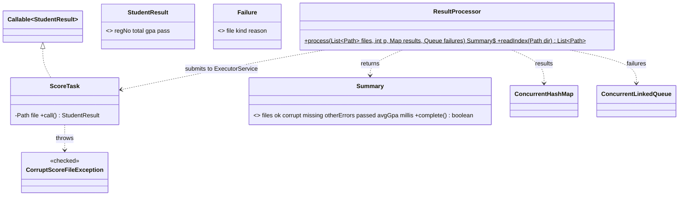

# Q7 – Design a Concurrent, Fault-Tolerant Processor from First Principles (K5)

> Pair-work note: Stage 2 (Student A) and Stage 3 (Student B) were both done by me (Nithish G); the joint stages are written jointly.

## Stage 1 – Interpret the problem (Joint)

**Work that can run in parallel:** processing each of the 10,000 score files (read → validate → compute result) is **independent**. No file needs another file's data, so they can be processed in any order on any thread.

**Shared data:**

* the result table (register number → result);
* the failure list (file → reason);
* the summary counters.

The index of files to process is read once, before any parallel work, and is not modified afterwards.

**Failures that can occur, and how each must be handled:**

| Failure | Detected by | Handling |
|---|---|---|
| File listed but missing | `NoSuchFileException` while opening | record as MISSING, continue |
| Empty or truncated file | `readLine()` returns `null` | record as CORRUPT ("truncated file"), continue |
| Bad register number | regex `\d{9}` | CORRUPT, continue |
| Wrong number of marks | `split(",").length != 5` | CORRUPT, continue |
| Non-numeric mark | `NumberFormatException` → `CorruptScoreFileException` | CORRUPT, continue |
| Mark out of range (outside 0–100) | range check | CORRUPT, continue |
| Other I/O error (permission, disk) | `IOException` | record as OTHER, continue |
| Duplicate register number in two files | `putIfAbsent` returns non-null | record as OTHER, keep the first |
| A task hangs | `Future.get(30, SECONDS)` times out | cancel the task, record as OTHER, continue |
| Pool or JVM failure | – | the run aborts; `finally` shuts the pool down. Out of scope for per-file handling |

**Requirements as measurable statements:**

* **R1:** for an index of N files, `ok + corrupt + missing + other = N`. Every file is accounted for exactly once.
* **R2:** a corrupt or missing file never stops the run. All remaining files are still processed (verified with 226 corrupt + 96 missing files injected among 10,000).
* **R3:** the summary counts equal the injected counts (`corrupt = 226`, `missing = 96`, `ok = 9,678`) and the hand-computed counts for the 10-file sample.
* **R4:** the 10,000 files are processed in **< 1 s** on the lab machine.
* **R5:** results are deterministic: the same counts and the same per-student result for every pool size and every run.

## Stage 2 – Design (Student A)

**ExecutorService, Callable and Future:**

* Each file becomes one `ScoreTask implements Callable<StudentResult>`. Its `call()` reads, validates and computes, and **throws** a checked exception on a bad file (`CorruptScoreFileException`, `IOException`). Callable was chosen over Runnable because a task must *return* a result *or* report why it failed.
* A fixed thread pool `Executors.newFixedThreadPool(p)` runs the tasks. `submit()` returns a `Future<StudentResult>` per file.
* The coordinator thread calls `future.get(timeout)` for each file. A failed task surfaces as an `ExecutionException` whose `getCause()` is the original exception. It is classified and recorded, and the loop continues.

**Concurrent collections for shared results:**

* `ConcurrentHashMap<String, StudentResult>` for results. Inserts by many threads need no external lock, and `putIfAbsent` is atomic, which detects duplicate register numbers.
* `ConcurrentLinkedQueue<Failure>` for failures: a lock-free, non-blocking append, and order does not matter.
* In my design only the coordinator writes to them (as it reads futures). The concurrent types keep the design correct if tasks are later changed to write directly, and allow the results to be read while the run is in progress. A plain `HashMap` would be unsafe as soon as two threads write.

**Exception handling so that one failure does not stop the run:**

* The task does **not** catch its own validation failures. It throws them, so the failure carries a type and a message.
* The executor captures any exception inside the `Future`, so a pool thread never dies and the pool never shrinks.
* The coordinator wraps **each** `get()` in its own `try/catch (ExecutionException | TimeoutException)`. One bad file therefore affects only its own iteration.
* `finally { pool.shutdown(); awaitTermination(...) }` always releases the threads.

**Class diagram:**



**Pseudocode:**

```
ALGORITHM ProcessResults
INPUT : list files[0..N-1], pool size p
OUTPUT: Summary, results map, failures queue
BEGIN
1.  pool ← NEW FixedThreadPool(p)
2.  FOR i ← 0 TO N-1 DO  futures[i] ← SUBMIT(pool, ScoreTask(files[i]))  END FOR
3.  FOR i ← 0 TO N-1 DO
4.      TRY
5.          r ← GET(futures[i], timeout 30 s)
6.          IF results.putIfAbsent(r.regNo, r) ≠ NULL THEN failures.add(files[i], OTHER, "duplicate") END IF
7.      CATCH ExecutionException e
8.          IF e.cause IS NoSuchFileException THEN kind ← MISSING
9.          ELSE IF e.cause IS CorruptScoreFileException THEN kind ← CORRUPT
10.         ELSE kind ← OTHER END IF
11.         failures.add(files[i], kind, e.cause)
12.     CATCH TimeoutException
13.         CANCEL(futures[i]); failures.add(files[i], OTHER, "timed out")
14.     END TRY
15. END FOR
16. FINALLY shutdown(pool); awaitTermination(pool)
17. RETURN Summary(N, |results|, count(CORRUPT), count(MISSING), count(OTHER), ...)
END

ALGORITHM ScoreTask.call(file)
1.  OPEN file (try-with-resources)              // NoSuchFileException if missing
2.  reg ← line 1; marks ← line 2
3.  IF reg = NULL OR marks = NULL THEN THROW Corrupt("truncated") END IF
4.  IF reg NOT MATCHES 9 digits THEN THROW Corrupt("bad register number") END IF
5.  parts ← SPLIT(marks, ","); IF |parts| ≠ 5 THEN THROW Corrupt("expected 5 marks") END IF
6.  FOR each m IN parts DO
7.      IF m not an integer THEN THROW Corrupt("non-numeric") END IF
8.      IF m < 0 OR m > 100 THEN THROW Corrupt("out of range") END IF
9.      total ← total + m; points ← points + GradePoint(m); IF m < 50 THEN pass ← FALSE END IF
10. END FOR
11. RETURN StudentResult(reg, total, points / 5, pass)
```

## Stage 3 – Implement and Measure (Student B)

### Hand-checked small set (`sample/`, committed)

The 10 index entries are 5 valid files, 4 corrupt files of different kinds, and 1 missing file (`s09.txt` is listed but absent). Grade points: ≥ 90 → 10, ≥ 80 → 9, ≥ 70 → 8, ≥ 60 → 7, ≥ 50 → 6, else 0 (fail).

| File | Content | Hand-computed | Program |
|---|---|---|---|
| s01 | 95, 88, 91, 79, 84 | total 437; GP 10+9+10+8+9 = 46 → **9.2**, pass | 437, 9.2, pass ✔ |
| s02 | 45, 60, 72, 55, 50 | 282; 0+7+8+6+6 = 27 → **5.4**, **fail** (45) | 282, 5.4, fail ✔ |
| s03 | 70 × 5 | 350; **8.0**, pass | ✔ |
| s04 | 100 × 5 | 500; **10.0**, pass | ✔ |
| s05 | 50, 50, 50, 50, 49 | 249; 6+6+6+6+0 = 24 → **4.8**, fail | ✔ |
| s06 | `81,AB,…` | CORRUPT – non-numeric | `non-numeric mark 'AB'` ✔ |
| s07 | 3 marks | CORRUPT – count | `expected 5 marks, found 3` ✔ |
| s08 | `19251X008` | CORRUPT – reg no | `bad register number` ✔ |
| s09 | (absent) | MISSING | `NoSuchFileException` ✔ |
| s10 | `…,101` | CORRUPT – range | `mark out of range 101` ✔ |

Hand summary: files 10, ok 5, corrupt 4, missing 1, passed 3, average GPA (9.2 + 5.4 + 8.0 + 10 + 4.8) / 5 = **7.48**.

Program: `Summary[files=10, ok=5, corrupt=4, missing=1, otherErrors=0, passed=3, avgGpa=7.48, …] complete=true` ✔

### 10,000 files with injected faults

The generator (fixed seed) wrote 10,000 index entries: **226 corrupt** (4 kinds, rotated) and **96 missing**. All pool sizes ran after a warm-up run (JIT and OS file cache).

| Pool size | Run 1 (ms) | Run 2 (ms) | Run 3 (ms) | ok | corrupt | missing | Counts correct |
|---|---|---|---|---|---|---|---|
| 1 | 303 | 302 | 284 | 9,678 | 226 | 96 | ✔ |
| 2 | 260 | 280 | 261 | 9,678 | 226 | 96 | ✔ |
| 4 | 283 | 283 | 275 | 9,678 | 226 | 96 | ✔ |
| 8 | 249 | 266 | 280 | 9,678 | 226 | 96 | ✔ |
| 16 | 257 | 270 | 260 | 9,678 | 226 | 96 | ✔ |

All requirements (R1–R5) are met: the run is complete, the counts equal the injected faults, and it takes ≈ 0.3 s (< 1 s).

**Where the time goes** (single thread): opening and reading the 10,000 files takes **286 ms**, while parsing and validating the same data in memory takes **5.8 ms**. Read-only work with p = 1/2/4/8 threads takes 286/266/267/247 ms. Over 98 % of the time is spent in file-system system calls (`open`/`read`/`close`). The `time` output showed 4.9 s of *system* time against 2.8 s of user time. The macOS file system serialises much of this metadata work, so extra threads barely help.

**The same design with CPU-heavy work** (each file also needs 5,000 SHA-256 rounds, simulating heavier validation or analytics):

| p | 1 | 2 | 4 | 8 | 16 |
|---|---|---|---|---|---|
| ms | 1,787 | 899 | 478 | 330 | 305 |

The design scales almost linearly up to 4 threads (3.7×) and reaches 5.4× at 8, then flattens. The CPU has 10 cores, and the file-reading part (≈ 280 ms) remains serial.

**Failures not handled correctly:** none in the final runs. Every injected fault was classified correctly, no exception escaped, and no task timed out. One issue surfaced during testing of the *alternatives*: a `parallelStream` without a per-element `catch` aborted the **entire** pipeline at the first corrupt file (`CorruptScoreFileException: expected 5 marks, found 3`). My design avoids this by construction. Separately, a first version of that test used `.count()`, which JDK 17+ can compute *without running* the `map` step, so it silently tested nothing. It was changed to `.toList()`.

## Stage 4 – Defend the design (Joint)

**Recommended pool size: p = 4** for this I/O-bound job (about the number of storage queues worth keeping busy). Use p ≈ the number of cores (8–10 here) only if per-file CPU work is significant.

**Why more threads did not always help:**

* The work is dominated by file-system calls (98 %), which the OS largely serialises.
* Threads beyond about 2–4 just queue for the same kernel locks and the disk. They also add context switches and stack memory (2 MB reserved each).
* Even in the CPU-bound version, going from 8 to 16 threads gained almost nothing: the machine has 10 cores, and Amdahl's law applies to the serial read part (≈ 280 ms of 1,787 ms ⇒ maximum speed-up ≈ 6.4×; measured 5.9×).

**How the design guarantees a complete and correct summary:**

1. Exactly one `Future` is created per index entry, and the coordinator visits **every** future exactly once. Each visit ends in exactly one of: a result, or a failure (missing / corrupt / other / timeout). Therefore `ok + corrupt + missing + other = N`, and `Summary.complete()` asserts this (true in every run).
2. Exceptions are contained at the task boundary (`Future`) and caught per iteration, so no single file can abort the loop.
3. Results go into a thread-safe map with atomic `putIfAbsent`. Duplicates are detected, not silently overwritten.
4. The summary is built only after the coordinator has called `get()` on every future, which gives happens-before visibility of every task's result. `finally` always shuts down the pool.

**One remaining limitation:** all `Future`s and results are held in memory, which is fine for 10,000 files (a few MB) but O(N). The run is also not *resumable*: if the JVM crashes at file 9,000, everything is reprocessed. For 1,000,000 files I would process in batches, stream results to a database or file, and checkpoint the last completed index. A smaller limitation: a task that ignores interruption cannot be truly cancelled by the timeout. The timeout only stops *waiting* for it.

## Alternative Concept and Complexity Analysis – parallel streams, or one thread per file

```java
// Parallel stream: failures must be caught INSIDE the lambda, otherwise the whole stream aborts
files.parallelStream().forEach(f -> {
    try { results.put(..., new ScoreTask(f).call()); }
    catch (Exception e) { failures.add(new Failure(f.toString(), classify(e), e.toString())); }
});

// One thread per file
for (Path f : files) { Thread t = new Thread(() -> process(f)); threads.add(t); t.start(); }
for (Thread t : threads) t.join();
```

**Measured on the same 10,000 files:**

| Approach | Time | ok / failed | Threads | Failure handling |
|---|---|---|---|---|
| ExecutorService, p = 4 | 275–283 ms | 9,678 / 322 | 4 | per-future `ExecutionException`, with type preserved |
| `parallelStream` (common pool, 9 workers) | 284 ms | 9,678 / 322 | 9 (+ caller) | must catch inside the lambda; without it the **whole pipeline aborted** at the first corrupt file |
| One thread per file | 297 ms | 9,678 / 322 | **10,000 created** (peak 24 alive) | each thread must catch and record its own failure; an uncaught exception just kills that thread silently (printed to stderr), so the summary has no record of it |

| | Total time (n files, p threads, per-file time t) | Memory (threads × stack) |
|---|---|---|
| ExecutorService | ≈ n·t / p (bounded by the I/O limit) | p × 2 MB reserved (here 4 × 2 MB) + O(n) futures |
| parallelStream | ≈ n·t / (cores − 1); pool size is not chosen per job, and the common pool is shared with every other parallel stream in the JVM | (cores − 1) × 2 MB + O(n) results |
| Thread per file | ≈ n·t / k with k = the number actually running, plus **n thread creations** (~50–100 µs each) | up to n × 2 MB reserved *if they overlap* (10,000 × 2 MB = 20 GB of address space). Here the files are tiny, so at most 24 were alive at once; with slower files (network storage) all 10,000 would be alive and the JVM would hit `OutOfMemoryError: unable to create native thread` |

All three take about 0.3 s here, because the file system is the bottleneck. **The ExecutorService design is preferred.** It has a bounded and chosen thread count (O(p) memory, independent of n), typed failure propagation through `Future`, timeouts and cancellation, and it does not depend on a shared global pool.
