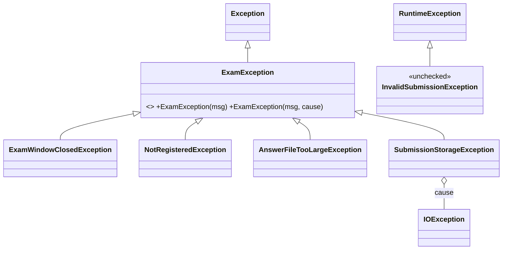
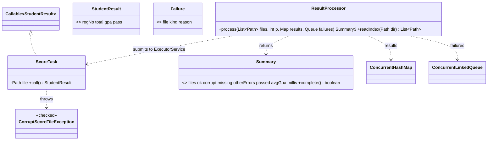

# CSA09 – Programming in Java – Assignment 3 Report

## Cover Page

| | |
|---|---|
| **GitHub Repository Link** | https://github.com/Nithish250707/CSA09-192511478-Assignment3 |
| Name | Nithish G |
| Register Number | 192511478 |
| Programme | B.E. Computer Science and Engineering, SIMATS Engineering, Chennai |
| Course | Programming in Java (CSA0921; printed as CSA09 in the assignment) |
| Assignment | 3 – CO3: Exception Handling and Multithreading (pair work) |

---

## Contents

- [Q1 – Handling Failure in a Bank ATM Simulation (K4)](#q1--handling-failure-in-a-bank-atm-simulation-k4)
- [Q2 – User-Defined Exceptions and Propagation in an Online Examination Portal (K4)](#q2--user-defined-exceptions-and-propagation-in-an-online-examination-portal-k4)
- [Q3 – Resource Safety, Debugging and Robust Code (K4)](#q3--resource-safety-debugging-and-robust-code-k4)
- [Q4 – Thread Creation and the Thread Life Cycle (K4)](#q4--thread-creation-and-the-thread-life-cycle-k4)
- [Q5 – Race Conditions in a Cinema Seat-Booking System (K4)](#q5--race-conditions-in-a-cinema-seat-booking-system-k4)
- [Q6 – Deadlock and Inter-Thread Communication (K4)](#q6--deadlock-and-inter-thread-communication-k4)
- [Q7 – Design a Concurrent, Fault-Tolerant Processor from First Principles (K5)](#q7--design-a-concurrent-fault-tolerant-processor-from-first-principles-k5)

All program outputs quoted below are copied from the `output.txt` file in each task folder, produced by actually running the code (see README for commands).

---

<!-- folder: Q1 -->
## Q1 – Handling Failure in a Bank ATM Simulation (K4)

> **Pair-work note.** No partner was assigned in the brief I received, so I (Nithish G, 192511478) carried out **both** the Student A and Student B responsibilities in this repository. The assignment also requires both students to execute every question in their own repository. Each section is labelled.

### Shared group work

### Every point at which the withdrawal can fail, classified

| # | Failure point | Exception / error | Kind |
|---|---|---|---|
| 1 | Card-reader file missing | `FileNotFoundException` | **checked** (`IOException`) |
| 2 | Card-reader read error (device fault) | `IOException` | **checked** |
| 3 | Card holds garbage (`ABC-1001`) | `NumberFormatException` from `Long.parseLong` | unchecked |
| 4 | User types letters (`abc`) | `InputMismatchException` from `Scanner.nextInt` | unchecked |
| 5 | User enters nothing (input stream ends) | `NoSuchElementException` | unchecked |
| 6 | Negative / zero amount, or not a multiple of 100 | `IllegalArgumentException` (thrown by `withdraw`) | unchecked |
| 7 | Amount > balance | `InsufficientFundsException` (user-defined) | **checked** – the caller must handle it and can recover |
| 8 | Account not in the bank's map | `NullPointerException` (unboxing `null`) | unchecked – a **bug**, deliberately left uncaught to show a stack trace |
| 9 | JVM out of memory / stack overflow | `OutOfMemoryError`, `StackOverflowError` | **Error** – not caught; the program cannot recover |

The implementation (`AtmWithdrawal.java`) uses `try`, six `catch` clauses including the multi-catch `InputMismatchException | NumberFormatException`, and `finally`. Tests T1–T9 were run with valid and invalid inputs.

### Student A – Exception Design

### Relevant part of the Throwable hierarchy

```
java.lang.Object
 └── Throwable
      ├── Error  (unchecked, not caught)
      │    └── VirtualMachineError → OutOfMemoryError, StackOverflowError
      └── Exception
           ├── IOException  (checked)
           │    └── FileNotFoundException  (checked)
           ├── InsufficientFundsException  (checked, user-defined)
           └── RuntimeException  (unchecked)
                ├── IllegalArgumentException
                │    └── NumberFormatException
                ├── NoSuchElementException
                │    └── InputMismatchException
                └── NullPointerException
```

### Failure point → exception → kind → where it is caught

| Failure point | Exception type | Checked? | Where caught |
|---|---|---|---|
| Card file missing | `FileNotFoundException` | checked | `main`, 1st catch |
| Card read failure | `IOException` | checked | `main`, 2nd catch (`readCard` declares `throws IOException`) |
| Corrupt card / letters typed | `NumberFormatException` / `InputMismatchException` | unchecked | `main`, 3rd catch (multi-catch) |
| No input | `NoSuchElementException` | unchecked | `main`, 4th catch |
| Negative or non-multiple-of-100 amount | `IllegalArgumentException` | unchecked | `main`, 5th catch |
| Amount > balance | `InsufficientFundsException` | checked | `main`, 6th catch (`withdraw` declares `throws`) |
| Unknown account | `NullPointerException` | unchecked | **not caught** – terminates `main` after `finally` |
| JVM failure | `Error` | unchecked | not caught |

### Justifying the order of the catch blocks

The rule is **subclass before superclass**, because the first matching `catch` wins.

* `FileNotFoundException` must come before `IOException` (its superclass), otherwise the "missing card" message could never be shown.
* The multi-catch `InputMismatchException | NumberFormatException` must come before `NoSuchElementException` and `IllegalArgumentException`, because `InputMismatchException extends NoSuchElementException` and `NumberFormatException extends IllegalArgumentException`. In the wrong order, letters typed would be reported as "no amount entered" and a corrupt card as "invalid amount".
* The two members of the multi-catch must not be related to each other (Java forbids `A | B` when B is a subclass of A).
* Unrelated types (`InsufficientFundsException`) can go anywhere.

### What the finally block guarantees

`finally` runs on **every** path out of the `try`: normal completion (T1), every caught exception (T2–T8) and even the **uncaught** `NullPointerException` (T9: `[finally] Card ejected, session closed` is printed *before* the stack trace). In this program it guarantees:

* the card is ejected (the user's card is never kept);
* the `Scanner` on `System.in` is closed;
* the session-end log line is written.

It would *not* run only if the JVM itself dies (`System.exit()` inside `try`, power loss, or the process being killed).

### Student B – Testing and Tracing

### Test inputs, the catch block reached, and whether finally ran (real output, `output.txt`)

| Test | Card file | Typed | Path intended | Catch block executed | finally? | Result |
|---|---|---|---|---|---|---|
| T1 | 1001 | 2000 | normal | none | ✔ | Dispensed Rs 2000, balance 3000 |
| T2 | 1001 | `abc` | letters | `InputMismatchException \| NumberFormatException` | ✔ | "Not a number: InputMismatchException" |
| T3 | 1001 | `-500` | negative | `IllegalArgumentException` | ✔ | "amount must be positive: -500.0" |
| T4 | 1002 (Rs 300) | 1000 | over balance | `InsufficientFundsException` | ✔ | "requested Rs 1000.0 but balance is Rs 300.0" |
| T5 | (missing) | 500 | missing file | `FileNotFoundException` | ✔ | "Card reader file missing" |
| T6 | `ABC-1001` | 500 | corrupt card | multi-catch (as `NumberFormatException`) | ✔ | `For input string: "ABC-1001"` |
| T7 | 1001 | *(nothing)* | no input | `NoSuchElementException` | ✔ | "No amount entered" |
| T8 | 1001 | 250 | not multiple of 100 | `IllegalArgumentException` | ✔ | "multiples of Rs 100 only" |
| T9 | 9999 (unknown) | 500 | unknown account | **none – uncaught** | ✔ (before the trace) | stack trace, exit code 1 |

### Stack trace of one uncaught exception (T9), explained line by line

```
Exception in thread "main" java.lang.NullPointerException: Cannot invoke "java.lang.Double.doubleValue()" because "bal" is null
	at AtmWithdrawal.withdraw(AtmWithdrawal.java:35)
	at AtmWithdrawal.main(AtmWithdrawal.java:49)
```

* **Line 1:** the thread that died (`main`), the exception class, and the *helpful NPE message* (JDK 14+). Unboxing `Double bal` called `doubleValue()` on `null`, because account 9999 is not in the map.
* **Line 2:** the top frame, where the exception was *created*: method `withdraw`, source line 35 (`double balance = bal;`).
* **Line 3:** the caller, `main` at line 49 (`double left = withdraw(account, amount);`). No catch in `main` matches an NPE, so it propagated out of `main` and the default handler printed this trace. Frames are listed innermost first, so read the trace from the top to find the cause and from the bottom to see how the program got there.

The fix is to check `if (bal == null) throw new AccountNotFoundException(...)`. The NPE is shown on purpose: it is a programming bug, and catching it would only hide the bug.

### Broader catch placed before a narrower one

`negative/WrongOrder.java` puts `NoSuchElementException` before `InputMismatchException`, and `negative/CatchAllFirst.java` puts `Exception` before `NumberFormatException`. Real compiler output:

```
negative/WrongOrder.java:13: error: exception InputMismatchException has already been caught
negative/CatchAllFirst.java:8: error: exception NumberFormatException has already been caught
```

Java turns the mistake into a **compile-time error** (an unreachable catch clause), so the wrong order can never ship.

### Joint design question – one `catch (Exception e)` for everything?

**When it is acceptable:**

1. At the **outermost boundary** of a program or a thread (`main`, a request handler, the ATM's top-level session loop), *after* all specific handlers, as a last-resort safety net that logs the full stack trace, shows "Service temporarily unavailable" and keeps the machine running for the next customer.
2. When every failure really has the **same recovery** (e.g. a retry loop around one remote call).

**What is lost by catching only `Exception`:**

* **Specific recovery:** a missing card ("insert card again") is a different action from insufficient funds ("show balance, ask for a smaller amount"), which is different from letters typed ("re-enter the number").
* **Accurate messages:** the customer sees one generic message.
* **Compiler help:** checked exceptions no longer force each failure to be thought about separately.
* **Bug visibility:** the T9 `NullPointerException` (a programming bug) would be swallowed as if it were a user error, and the defect would never be fixed.
* It also catches `InterruptedException` and other exceptions the code did not mean to handle.

`Error`s are not caught by `catch (Exception)` at all; that is correct, as they cannot be recovered from.

### Alternative Concept and Complexity Analysis – no exceptions, error codes

```java
static int withdraw(Scanner in) {
    if (!in.hasNextInt()) { if (in.hasNext()) in.next(); return ERR_NOT_NUMBER; }   // -1
    int amount = in.nextInt();
    if (amount <= 0) return ERR_NEGATIVE;                                           // -2
    if (amount > balance) return ERR_FUNDS;                                         // -3
    balance -= amount;
    return OK;
}
// caller:
int code = withdraw(in);
if (code == ERR_NOT_NUMBER) ... else if (code == ERR_NEGATIVE) ... else if ...
```

Real output: `'500' -> 0, 'abc' -> -1, '-200' -> -2, '999999' -> -3`.

**Readability and number of checks:**

* With error codes, **every** caller on every level must test the return value: `readCard`, `withdraw` and the session loop each need their own `if (code < 0)` chain.
* For f failure kinds and d call levels, that is O(f × d) checks scattered through the normal logic. A forgotten check silently continues with a wrong value.
* `-1` can also collide with a legitimate return (a balance can't be −1, but a "remaining amount" might be 0).
* Exceptions keep the "happy path" linear, and they propagate automatically to the one place that can handle them.
* `hasNextInt()` does make the pre-check cheaper and cleaner for *expected* user typos, so the best design uses both: pre-check predictable input errors, and use exceptions for exceptional conditions (missing card, I/O failure, insufficient funds).

**Measured cost** (`AtmErrorCodes`, 1,000,000 failures, after warm-up):

| Mechanism | Time per failure | Space per failure |
|---|---|---|
| Return an error code | 0.0–2.4 ns | none (an `int` in a register) |
| `throw` + `catch` of a normal `Exception` | **≈ 191 ns** | 1 exception object + the captured stack trace: O(d) for call depth d (`fillInStackTrace` walks the stack; `StackTraceElement` objects are created only if `getStackTrace()` is called) |
| `throw` + `catch` without a stack trace (`super(msg, null, false, false)`) | ≈ 3.5 ns | 1 small object, O(1) |

So **Big-O time per failure:** error code O(1); exception O(d), dominated by capturing the stack trace, not by the `throw` itself. In absolute terms, 191 ns per failed withdrawal is nothing next to a human typing a PIN. Exceptions should simply not be used for control flow in a tight loop of millions of iterations.

*Source code and raw output: [`Q1/`](https://github.com/Nithish250707/CSA09-192511478-Assignment3/tree/main/Q1)*

---

<!-- folder: Q2 -->
## Q2 – User-Defined Exceptions and Propagation in an Online Examination Portal (K4)

> Pair-work note: both the Student A and Student B parts were done by me (Nithish G), and they are labelled below.

### Shared group work – design and implementation (`portal/`)

| Layer | Class | Rule it checks | Throws |
|---|---|---|---|
| Controller | `SubmissionController.handle` | exam window still open | `ExamWindowClosedException`; also **catches everything** and builds the student message |
| Service | `SubmissionService.submit` | student registered for the course; arguments not blank | `NotRegisteredException`, `InvalidSubmissionException`; `throws ExamException` passes storage errors up |
| Storage | `SubmissionStorage.store` | file ≤ 500 KB; disk write succeeds | `AnswerFileTooLargeException`, `SubmissionStorageException` (wraps the `IOException`) |

Checked vs unchecked:

* All **rule violations a student can cause and the portal must answer** are checked subclasses of `ExamException`. The compiler then forces every layer to either handle them or declare them.
* `InvalidSubmissionException` (blank regNo) is **unchecked** (`RuntimeException`). It means a *caller bug*: the UI should never send a blank regNo, so forcing every method to declare it would only add noise.

`throw` is used in each layer, and `throws` on `store`, `submit` and `save`. **Chaining:** `new SubmissionStorageException("Could not store …", e)` keeps the `IOException` as the cause.

### Complete the Code – `complete/StorageDemo.java`

```java
// TODO 1
throw new SubmissionStorageException("Could not store " + fileName, e);
```

| | Output |
|---|---|
| Expected | `Saved answer01.pdf` / `Error: Could not store answer02.pdf` / `Cause: Disk quota exceeded` |
| **Actual** | `Saved answer01.pdf` / `Error: Could not store answer02.pdf` / `Cause: Disk quota exceeded` ✔ |

**What if the IOException were not passed to the constructor?** I ran this as an experiment (`complete_nocause/`, which passes `null` as the cause). The `Error:` line still prints, but `e.getCause()` returns `null`, so `e.getCause().getMessage()` throws:

```
Exception in thread "main" java.lang.NullPointerException: Cannot invoke "java.lang.Throwable.getMessage()"
because the return value of "ExamException.getCause()" is null
	at StorageDemo.main(StorageDemo.java:35)
```

The **Cause line is never printed**. Instead the program crashes with an NPE inside the error handler, and the real reason ("Disk quota exceeded") is gone.

### Student A – Exception Hierarchy and Propagation Design

### Class diagram



### Why each exception is checked or unchecked

| Exception | Kind | Reason |
|---|---|---|
| `ExamException` (base) | checked | Lets the controller catch "any portal rejection" in one clause; is the root for chaining constructors |
| `ExamWindowClosedException` | checked | An expected business outcome that must be shown to the student. Forgetting to handle it would leave the student with no answer |
| `NotRegisteredException` | checked | Same: a normal, recoverable rejection ("contact the exam cell") |
| `AnswerFileTooLargeException` | checked | The student can recover by compressing the file, so the caller should be forced to tell them |
| `SubmissionStorageException` | checked | Infrastructure failure the controller must turn into a "retry" message. Wraps `IOException` so upper layers need not know about files |
| `InvalidSubmissionException` | **unchecked** | A programming error (precondition violation). It should be fixed in code, not handled at runtime, so it does not belong in every `throws` clause |

### Propagation path of one exception (disk full)

```
Disk.write()                  throws IOException("No space left on device")
   │  (checked, caught immediately – storage is the only layer allowed to know about I/O)
   ▼
SubmissionStorage.store()     catch (IOException e) → throw new SubmissionStorageException("Could not store ans.pdf …", e)
   │  declared: throws SubmissionStorageException
   ▼
SubmissionService.submit()    does NOT catch – passes it on (declared: throws ExamException)
   │
   ▼
SubmissionController.handle() catch (SubmissionStorageException e) → log full chain, return polite message
   │
   ▼
Student sees: "REJECTED: Server could not save your answer. It has NOT been submitted; please retry. (ref 5674cd4d)"
```

### Where it is finally handled and what the student sees

It is handled **only in the controller**, the single layer that talks to the user. The student sees a clear, non-technical message saying that the answer was *not* saved and that they should retry, plus a reference code. Engineers see the full chain in the server log (`caused by: java.io.IOException: No space left on device (/exam-store)`), matched by that reference. The student never sees the path, the stack trace or `IOException`.

### Student B – Failure Scenarios and Chaining Evidence

### One scenario per exception – test table (real output)

| # | Scenario | Exception expected | Observed message to student | Pass |
|---|---|---|---|---|
| 1 | valid, in time, registered, 120 KB | none | `ACCEPTED: ans.pdf submitted.` | ✔ |
| 2 | submitted at 12:05, window closed 12:00 | `ExamWindowClosedException` (controller) | `REJECTED: Exam window closed at 12:00. Late submissions are not accepted.` | ✔ |
| 3 | 192511001 submits for CSA09 | `NotRegisteredException` (service) | `REJECTED: 192511001 is not registered for CSA09. Contact the exam cell.` | ✔ |
| 4 | 800 KB file | `AnswerFileTooLargeException` (storage) | `REJECTED: big.pdf is 800 KB; limit is 500 KB. Compress the file and resubmit.` | ✔ |
| 5 | disk full, cause chained | `SubmissionStorageException ← IOException` | retry message; server log shows `caused by: java.io.IOException: No space left on device` | ✔ |
| 6 | disk full, **cause not passed** | `SubmissionStorageException` (no cause) | same message; server log shows `caused by: <none - root cause lost>` | ✔ (information lost) |
| 7 | blank regNo (caller bug) | `InvalidSubmissionException` (unchecked) | `REJECTED: invalid request (regNo must not be blank)` | ✔ |

### Exception chaining with `getCause()` – full chained stack trace

```
SubmissionStorageException: Could not store ans.pdf for 192511478
	at SubmissionStorage.store(Layers.java:14)
	at SubmissionService.submit(Layers.java:28)
	at PortalDemo.main(PortalDemo.java:24)
Caused by: java.io.IOException: No space left on device (/exam-store)
	at Disk.write(Exceptions.java:32)
	at SubmissionStorage.store(Layers.java:12)
	... 2 more
getCause() = java.io.IOException: No space left on device (/exam-store)
```

The `Caused by:` section is the original `IOException` with *its own* stack trace, which shows the exact low-level call (`Disk.write`, line 32). `... 2 more` means the remaining frames are the same as in the enclosing trace.

### What is lost when re-thrown without the cause

```
SubmissionStorageException: Could not store ans.pdf for 192511478
	at SubmissionStorage.store(Layers.java:15)
	at SubmissionService.submit(Layers.java:28)
	at PortalDemo.main(PortalDemo.java:32)
getCause() = null
```

Lost:

* the **real reason** (disk full, versus permission denied, versus network share down);
* the low-level **message** ("No space left on device (/exam-store)", which even names the mount point);
* the **stack frames inside the I/O layer** (`Disk.write`).

An engineer can no longer tell *which* of many possible I/O faults happened, so the incident cannot be diagnosed from the log. As the StorageDemo experiment shows, code that expects a cause also crashes with an NPE.

### Joint conclusion – why throw `SubmissionStorageException` instead of letting `IOException` travel to the UI?

1. **Abstraction / layering:** the controller and UI should depend on *portal* concepts, not on how storage is implemented. If storage moves from local disk to a database or S3, the failures become `SQLException` or `SdkException`, and every upper layer would have to change. With a wrapper, only the storage layer changes.
2. **Meaningful handling:** `SubmissionStorageException` tells the controller *what* failed in domain terms ("this student's answer was not stored"), so it can choose the right action (retry message, alert). A bare `IOException` might come from anywhere: a config file, a log file, the network.
3. **Security and user experience:** an `IOException` message leaks internal paths (`/exam-store`) and means nothing to a student.
4. **Nothing is lost:** chaining keeps the `IOException` as the cause for diagnosis.
5. **Checked-exception hygiene:** upper-layer method signatures declare `throws ExamException` instead of a growing list of low-level exceptions.

### Alternative Concept and Complexity Analysis – make the custom exceptions unchecked

```java
class ExamException extends RuntimeException { ... }                   // was: extends Exception
void store(...) { ... throw new SubmissionStorageException(...); }     // no 'throws' clause needed
void submit(...) { storage.store(...); }                                // no 'throws', no compiler check
String handle(...) { try { ... } catch (ExamException e) { ... } }     // still works – but only if remembered
```

What changes:

* The `throws` clauses disappear from `store`, `submit` and `save`.
* Callers are no longer *forced* to handle or declare them. A new caller (a batch-upload tool) could forget the `try` entirely, and the exception would reach the thread's default handler, so a student would get a crash page.
* Lambdas and streams become easier to use, because checked exceptions cannot cross `Function`.
* `IOException` itself is still checked, so the wrapping in the storage layer stays.

The handling *logic* and runtime behaviour are unchanged; only compile-time enforcement is lost. I keep them checked because every one is a normal, recoverable business outcome the student must be told about.

**Cost of capturing stack traces (measured, 200,000 exceptions per row, `PortalDemo`):**

| Call depth d | New exception | New chained exception (cause + wrapper) | Frames recorded |
|---|---|---|---|
| 1 | 231 ns | 454 ns | 2 |
| 10 | 344 ns | 682 ns | 11 |
| 50 | 954 ns | 1,865 ns | 51 |

* **Time:** creating an exception costs O(d), because `fillInStackTrace()` walks d frames. Checked or unchecked makes **no** difference to the cost; the distinction exists only at compile time. A chained exception costs about 2× (two exceptions, each capturing its own trace).
* **Space:** one exception holds its message, its cause reference and a compact internal backtrace of O(d) frames. The `StackTraceElement[]` (≈ 32 B + Strings per frame) is created lazily, only when `getStackTrace()`/`printStackTrace()` is called. A chain of length c therefore holds O(c × d) frame data. The chain keeps the cause object alive as long as the wrapper is referenced, for example in a log queue.
* At under 2 µs per rejected submission, the cost is irrelevant to the portal. It would matter only if exceptions were thrown in a hot loop.

*Source code and raw output: [`Q2/`](https://github.com/Nithish250707/CSA09-192511478-Assignment3/tree/main/Q2)*

---

<!-- folder: Q3 -->
## Q3 – Resource Safety, Debugging and Robust Code (K4)

> Pair-work note: the roles are reversed in this question (A = debugging, B = design). I did both parts.

### Shared group work

`ReportGenerators.java` contains two versions:

* **`manual()`**: try–catch–finally with manual `close()`. Each store reader is closed at the end of its loop iteration, and the writer is closed in `finally`.
* **`withResources()`**: try-with-resources for the writer *and* for each store reader.

Input: `stores/` holds 5 valid store files; `stores_bad/` is the same set, except that `store3.csv` has the amount `TWENTY` on line 3.

**Both versions produce the same report** (real output):

```
manual ok=true, twr ok=true, reports identical: true
    store1.csv,502.00 ... store5.csv,2102.00
    TOTAL,6510.00
open fds before=5 after=5
```

### Student A – Debugging and Experimental Analysis

### Breakpoints and step-through: where the manual version leaks

A scripted `jdb` session (`debug.sh`, full transcript in `debug_session.txt`) set breakpoints on line 27 (`new FileReader(path)` – *open*) and line 35 (`in.close()` – *close*), plus a catch-point on `NumberFormatException`:

```
Breakpoint hit: ... ReportGenerators.manual(), line=27     path = "stores_bad/store1.csv"   <- open store1
Breakpoint hit: ... ReportGenerators.manual(), line=35     path = "stores_bad/store1.csv"   <- close store1  ✔
Breakpoint hit: ... ReportGenerators.manual(), line=27     path = "stores_bad/store3.csv"   <- open store3
Exception occurred: java.lang.NumberFormatException (to be caught at: ReportGenerators.manual(), line=43)
  [4] ReportGenerators.manual (ReportGenerators.java:33)
main[4] locals:  path = "stores_bad/store3.csv"  in = instance of java.io.BufferedReader(id=937)
                 line = "item2,TWENTY"  total = 310.5
```

For store3, the line-35 breakpoint is **never hit**. Execution jumps from line 33 (`Double.parseDouble`) straight to the catch block at line 43. The local variable `in` still refers to an **open** `BufferedReader`. When the method returns, that reference is lost, but the file descriptor stays open. This is the leak point.

### An input that makes the manual version fail part-way

`stores_bad/store3.csv`:

```
item,amount
item1,310.50
item2,TWENTY      <- NumberFormatException
item3,330.50
```

The manual version wrote a **partial report**, which explains the complaint that "the report is sometimes incomplete":

```
store1.csv,502.00
store2.csv,902.00          (store3–5 and TOTAL missing)
```

### Files left open in each version, for the same failing input

Open file descriptors were counted from `/dev/fd` before and after each version:

| Version | fds before | fds after | Leaked |
|---|---|---|---|
| manual close() | 5 | 6 | **1** (the store3 reader) |
| try-with-resources | 6 | 6 | **0** |

**Reproducing "Too many open files"** (a server re-running the report every time, under `ulimit -n 64`):

```
after run 10: open fds = 16
after run 20: open fds = 26
...
after run 50: open fds = 56
run 59 FAILED: java.io.FileNotFoundException: stores_bad/store1.csv (Too many open files)  (open fds = 64)
```

The leak is exactly **1 descriptor per failed run**. At run 59 the process hit the OS limit, and from then on even *valid* files (`store1.csv`) could not be opened. That is the production symptom. (The JDK's `Cleaner` would eventually close leaked streams after a garbage collection, but nothing guarantees when, so the program cannot rely on it.)

### Logging which file caused the failure

Both versions record the file being processed in `current` and log it through `java.util.logging`:

```
[LOG SEVERE] manual: failed while processing stores_bad/store3.csv: java.lang.NumberFormatException: For input string: "TWENTY"
[LOG SEVERE] try-with-resources: failed while processing stores_bad/store3.csv: java.lang.NumberFormatException: For input string: "TWENTY"
```

### Student B – Design and Correctness

### Every resource and where it must be closed

| Resource | Opened at | Must be closed |
|---|---|---|
| `FileWriter` → `BufferedWriter out` (report file) | start of run | after the last line is written, **on every path**. Closing also *flushes* the buffer; without it the report can be empty |
| `FileReader` → `BufferedReader in` (one per store, f in total) | each loop iteration | at the end of **that iteration**, on every path, before the next store is opened |
| (underlying OS file descriptor of each) | with the `FileReader`/`FileWriter` | closed by closing the outermost wrapper (`BufferedReader.close()` closes the `FileReader`) |

### Why the manual version can leak when an exception occurs

`in.close()` is an ordinary statement placed *after* the loop that can throw. When `parseDouble` throws, control leaves the `try` block immediately: statements after the throw point, including `close()`, are skipped. The `finally` only closes `out`, because `in` is a local variable *inside* the loop and is out of scope there. Fixing this by hand needs a nested `try { … } finally { if (in != null) in.close(); }` around every reader, which is verbose, and a `close()` that throws can still *hide* the original exception.

### How try-with-resources guarantees closing, and the order

```java
try (BufferedWriter out = ...) {
    for (...) {
        try (BufferedReader in = ...) { ... }   // in.close() runs here on success OR exception
    }
}                                               // out.close() runs here on success OR exception
```

* The compiler generates the equivalent of a `finally` that calls `close()` on every resource whose initialiser **completed**, whether the block ends normally, by `return`, or by an exception.
* Resources are closed in **reverse order of declaration** (LIFO), so a resource is never closed while a resource declared later, which may depend on it, is still open.
* Real output with two resources:

```
open storeReader
open reportWriter
body throws
close reportWriter      <- last opened, first closed
close storeReader
```

### Suppressed exceptions – what and when

A suppressed exception occurs when the **body throws** and then **`close()` also throws**. Java keeps the *body's* exception as the primary one, since it is the real cause, and attaches the close failures to it with `addSuppressed()`, so no information is lost. Real output:

```
caught primary: java.io.IOException: read failed in body
suppressed   : java.lang.IllegalStateException: close failed: reportWriter
suppressed   : java.lang.IllegalStateException: close failed: storeReader
```

In the manual version, an exception thrown from `close()` inside `finally` would **replace** the body's exception, and the original cause would disappear.

### Joint engineering decision – when try-with-resources is not enough

try-with-resources guarantees that *resources are released*. It does not make the *report* correct or the program robust:

1. **Partial output.** If store3 fails half-way, the writer is closed cleanly, but the report still contains only store1 and store2, which looks like a valid but smaller report. Fix: write to `report.tmp` and atomically rename it (`Files.move(..., ATOMIC_MOVE)`) only after success, or write an explicit "INCOMPLETE" marker.
2. **One bad line aborts everything.** Robustness needs a *policy*: skip and log bad lines (or a bad store), continue with the others, and report failures in a summary (see Q7).
3. **Resources not opened in the `try` header.** A stream returned by a factory and stored in a field, or work handed to another thread, is not covered.
4. **Non-`AutoCloseable` resources and external state.** Locks, temp files to delete, database transactions to roll back, or a half-written network upload all need explicit `finally`, rollback or cleanup logic.
5. **The OS limit itself.** Opening thousands of store files *at the same time* (e.g. in parallel threads) can still exceed `ulimit` even if each is closed. This needs bounded concurrency.
6. **`close()` failures** (disk full during the final flush) are only *recorded* as suppressed exceptions. The code must still check and react to them.

### Alternative Concept and Complexity Analysis

The three closing strategies are: (a) try-with-resources (implemented), (b) explicit `close()` calls in a `finally` block, and (c) no closing at all.

```java
// (b) explicit close in finally - correct if done per reader:
for (String path : stores) {
    BufferedReader in = null;
    try {
        in = new BufferedReader(new FileReader(path));
        ...
    } finally {
        if (in != null) try { in.close(); } catch (IOException e) { log(e); }   // can hide body exception
    }
}

// (c) no closing at all:
for (String path : stores) { BufferedReader in = new BufferedReader(new FileReader(path)); ... }   // never closed
```

For a report reading f store files with L lines in total:

| Version | Processing time | Max file handles open at the moment of a failure | Handles still open *after* a failed run |
|---|---|---|---|
| try-with-resources | O(L) | **2** (1 reader + the writer) | 0 |
| explicit close in `finally` (per reader) | O(L) | 2 | 0 – but more code, and a `close()` exception can mask the original |
| my original manual version (close only on success) | O(L) | 2 | **1 per failed run**, so the process fails after about `ulimit − baseline` failed runs (measured: run 59 at `ulimit -n 64`) |
| no closing at all | O(L) | up to **f + 1** (every reader opened so far + the writer) | f + 1 per run (until a GC `Cleaner` happens to run), so the OS limit is reached after about `ulimit / (f + 1)` runs |

* **Time:** every version reads each line once, so O(L). Closing adds O(1) per file, which is negligible.
* **Space:** the real difference is in **file handles**. Correct closing keeps the count bounded by O(1), independent of f and of the number of runs. Without closing it grows as O(f) per run and O(f × runs) over the life of the server.

*Source code and raw output: [`Q3/`](https://github.com/Nithish250707/CSA09-192511478-Assignment3/tree/main/Q3)*

---

<!-- folder: Q4 -->
## Q4 – Thread Creation and the Thread Life Cycle (K4)

> Pair-work note: Student A and Student B parts were both done by me (Nithish G).
> Machine: 10-core Apple Silicon Mac, JDK 21. Default thread stack: `ThreadStackSize = 2048` KB (from `-XX:+PrintFlagsFinal`).

### Shared group work (`ScannerStations.java`)

Each station scans 25 scripts, sleeping 2–5 ms per script (simulated scanning I/O).

* **A – `extends Thread`:** `StationThread`.
* **B – `implements Runnable`:** `StationTask`, wrapped in `new Thread(task, name)`.
* `start()`, `sleep()`, `join()` and `isAlive()` are all used.
* Real output for A: `TOTAL scanned = 100`; the finish order was `[Station-2, Station-1, Station-4, Station-3]`. B gave `TOTAL scanned = 100` as well.

### Student A – Thread Design

### Two ways to create a thread

| | `extends Thread` | `implements Runnable` |
|---|---|---|
| How | override `run()` in a `Thread` subclass; `new StationThread(...).start()` | put the work in `run()` of a task class; `new Thread(task, name).start()` |
| Inheritance | uses up the single `extends`; a station can no longer extend e.g. `Scanner` | the task can extend any class and implement other interfaces |
| Separation | the *work* and the *worker* are the same object | the work (task) is separate from the worker (thread), so the same task type can run on a thread, a thread pool or a virtual thread |
| Sharing | each thread object has its own fields | one `Runnable` instance can be given to several threads if they should share state (with synchronisation) |
| When preferred | quick demos; when thread-specific behaviour is customised (rare) | **almost always**, especially with `ExecutorService` (which accepts `Runnable`/`Callable`, not `Thread` subclasses) |

### Life-cycle state diagram, with the states each station passes through

```
          new StationThread(...)
                  │
                  ▼
               [NEW]   ── observed: "before start: state=NEW isAlive=false"
                  │ start()
                  ▼
            [RUNNABLE] ◄──────────────┐  (scanning the next script)
                  │ Thread.sleep(2..5)│ time elapses
                  ▼                   │
          [TIMED_WAITING] ────────────┘ ── observed: "20 ms after start: state=TIMED_WAITING isAlive=true"
                  │ run() returns after 25 scripts
                  ▼
           [TERMINATED]  ── observed: "after join: state=TERMINATED isAlive=false"

 (other states, not used by a station:  BLOCKED  – waiting for a monitor lock;
                                        WAITING  – wait()/join() without timeout,
                                                   which is the state of *main* while it joins)
```

### Why calling `run()` instead of `start()` does not create a thread

`run()` is an ordinary method: calling it executes the body **on the caller's thread**, synchronously. `start()` asks the JVM to create a new OS thread, which then calls `run()`. Evidence:

```
=== C. run() instead of start() ===
  task executing in thread: main            <- direct.run()
  after run(): Station-X state=NEW (never started)
  task executing in thread: Station-X       <- direct.start()
```

After `run()`, the thread object is still `NEW`. No parallelism happened, and the four "stations" would scan one after another.

### How `join()` ensures the final total is printed only after all stations finish

`t.join()` blocks the calling thread (`main`, in state WAITING) until `t` is TERMINATED. `main` joins all four stations before summing `scanned`, so the sum cannot be computed early.

`join()` also creates a **happens-before** edge: all writes made by the station (its `scanned` count) are guaranteed to be visible to `main` after `join()` returns. That is why the total is always exactly 100, even though `scanned` is not `volatile` in `StationThread`. Without `join()`, `main` could print a partial total, or even 0.

### Student B – Behavioural Experiments

### Ten runs – finish order (same random seeds every run, so the work per station is identical)

| Run | Finish order |
|---|---|
| 1 | S1, S2, S3, S4 |
| 2 | S2, S1, S4, S3 |
| 3 | S2, S1, S4, S3 |
| 4 | S2, S1, S3, S4 |
| 5 | S1, S2, S3, S4 |
| 6 | S1, S2, S4, S3 |
| 7 | S1, S2, S3, S4 |
| 8 | S1, S2, S4, S3 |
| 9 | S2, S1, S3, S4 |
| 10 | S1, S2, S4, S3 |

There are **6 different orders in 10 runs**. S1/S2 and S3/S4 swap places because their total sleep times are close, so tiny differences in wake-up latency decide who finishes first.

### Thread priorities

CPU-bound stations were used, because a sleeping thread does not compete for the CPU at all. S1 = `MAX_PRIORITY` (10), others = `MIN_PRIORITY` (1). 10 runs:

| Runs | Result |
|---|---|
| 3–9 | S1 finished first in 7 of 10 runs (runs 3–9) |
| 1, 2, 10 | S3, S2 and S2 finished first |

**Interpretation:** there is no reliable effect. S1 is also *started first*, which by itself explains most of its wins. With 4 threads on a 10-core machine every thread gets its own core, so there is nothing to arbitrate. On macOS, HotSpot also does not map Java priorities to OS priorities by default (`ThreadPriorityPolicy`). Priorities are a *hint* and must never be used for correctness.

### A daemon station

```
### java ScannerStations daemon
  main ends now; daemon has scanned 7 of 500, isAlive=true
  (JVM exited - no 'daemon station finished' line was printed)
```

The JVM exits as soon as the last **non-daemon** (user) thread ends. The daemon station was killed after 7 of 500 scripts. Its `finally` blocks and the "finished" message never ran, so **193 + 300 scripts were silently lost**. Daemon threads therefore suit only background helpers (e.g. a progress monitor), never real scanning work.

### Explanation using the scheduler

The JVM uses native OS threads, and macOS's scheduler decides which runnable thread runs on which core and for how long. After each `sleep()`, a station becomes runnable again only when the OS timer fires and the scheduler dispatches it. That delay varies by microseconds to milliseconds, depending on other processes, core power states and timer coalescing. Over 25 sleeps these small variations accumulate and reorder stations whose work is similar. Priorities are only hints to that scheduler.

### Joint conclusion – why output order differs between runs, and why correctness must not depend on it

The order depends on **when the OS scheduler runs each thread**. That timing is non-deterministic: it depends on other load, the number of cores, timer resolution, JIT compilation and garbage-collection pauses, none of which the program controls. The Java Memory Model also guarantees ordering only through synchronisation (`join`, locks, `volatile`). Without those, two threads' actions have **no defined order**.

A correct program must give the same *result* (the total of 100, an identical report) for **every** possible interleaving. It must coordinate with `join()`, synchronised collections (`Collections.synchronizedList` for `finishOrder`) or futures, never with assumptions such as "station 1 is faster" or "priority 10 runs first". Code that only works for the order seen in testing will fail on a different machine or under load.

### Alternative Concept and Complexity Analysis – `ExecutorService` with a fixed pool

```java
ExecutorService pool = Executors.newFixedThreadPool(p);
List<Future<Integer>> results = new ArrayList<>();
for (Batch b : batches) results.add(pool.submit(() -> scan(b)));   // Callable<Integer>
int total = 0;
for (Future<Integer> f : results) total += f.get();                // replaces join()
pool.shutdown();
```

**Measured:** n = 400 scripts, 5 ms each (`Thread.sleep` overshoots to about 6.2 ms on macOS, so all times are about 1.24× the ideal).

| Approach | Time (ms) | Ideal n/p × 5 ms |
|---|---|---|
| 4 manual Threads (static split) | 618 | 500 |
| fixed pool p = 1 | 2,475 | 2,000 |
| fixed pool p = 2 | 1,233 | 1,000 |
| fixed pool p = 4 | 616 | 500 |
| fixed pool p = 8 | 311 | 250 |
| fixed pool p = 16 | 158 | 125 |

Completion time follows **⌈n/p⌉ × t** almost exactly: doubling p halves the time. Here the work is waiting (I/O-like), so even p = 16 on 10 cores keeps scaling. For CPU-bound scanning, the curve would flatten at p ≈ the number of cores.

| | Manual `Thread` objects | Fixed thread pool |
|---|---|---|
| Expected completion time | ≈ n/p batches × t, with a *static* split: if one station gets slower scripts, the others sit idle | ≈ n/p × t with *dynamic* load balancing: idle workers take the next task from the queue |
| Thread creation | p threads created per run, plus one per new batch if reused naively | p threads created once and reused for any number of tasks |
| Memory | p × stack size; reserved stack is 2 MB per thread here (`ThreadStackSize = 2048` KB) – mostly virtual, committed on demand | the same p × 2 MB, plus an O(n) task queue (one small object per submitted task) |
| Result collection | shared fields + `join()` | `Future.get()` returns each result *and* rethrows the task's exception as `ExecutionException` |

Big-O: time is O(n/p · t) for both; space is O(p · stack + n) for the pool and O(p · stack) for manual threads. The pool wins on *engineering*: reuse, load balancing, exception propagation and a clean shutdown.

*Source code and raw output: [`Q4/`](https://github.com/Nithish250707/CSA09-192511478-Assignment3/tree/main/Q4)*

---

<!-- folder: Q5 -->
## Q5 – Race Conditions in a Cinema Seat-Booking System (K4)

> Pair-work note: Student A and Student B parts were both done by me (Nithish G).

### Complete the Code – `SeatBooking.java`

**Run 1, as instructed: TODO 1 written WITHOUT `synchronized`** (`unsync/SeatBooking.java`):

```java
public void book(int seat) {
    if (!booked[seat]) {
        booked[seat] = true;
        bookingsMade++;
    }
}
```

**Run 2, TODO 1 completed correctly** (`SeatBooking.java`; the only difference is the keyword):

```java
public synchronized void book(int seat) { ...same body... }
```

| Version | 10 runs of the given `main()` |
|---|---|
| Without `synchronized` | 10, 10, 10, 10, 10, 10, 10, 10, 10, 10 |
| With `synchronized` | 10, 10, 10, 10, 10, 10, 10, 10, 10, 10 (**expected output `Seats sold: 10`** ✔) |

**Honest observation:** the given `main()` did *not* show the bug in 10 runs. Each user thread is started one after another with `start()`, which takes tens of microseconds, while `book()` runs in nanoseconds. Each thread usually finishes before the next one starts, so the threads rarely overlap inside `book()`. The program is still **incorrect**: a passing test only shows that the race did not happen in those runs. The experiments below make it happen on purpose.

**Why the unsynchronized version may sell more than 10 seats:**

* `if (!booked[seat]) { booked[seat] = true; bookingsMade++; }` is a *check-then-act* sequence with no lock. Two threads can both read `false` before either writes `true`, so both "sell" the seat and `bookingsMade` is incremented twice.
* `bookingsMade++` is itself three steps (read, add 1, write). Two threads can lose an update, so the counter can even be *lower* than the number of seats actually marked sold.
* Without synchronisation there is also no visibility guarantee: one thread's write to `booked[seat]` may not yet be visible to another.

### Shared group work

`RaceStudy.java` implements the unsynchronized booking, a synchronized **method** and a synchronized **block** (plus three alternatives), and attacks each with many threads released at the same instant by a `CountDownLatch`. Each version counts how many threads *believed* they sold a seat.

**The synchronized versions never double-booked:**

* the method version sold exactly 10 seats in all 10 runs of test A;
* the method, block, CAS, lock and map versions all sold exactly 1,000 of 1,000 seats in test B;
* the unsynchronized version sold 1,024 seats.

### Student A – Producing and Explaining the Race

### A test that reliably reproduces double booking

1. **Widen the window:** 10 seats and 100 threads, all released together by a `CountDownLatch`. The unsafe `book` sleeps 1 ms between the check and the act, simulating a payment-gateway call between "seat free?" and "mark sold".
2. **No artificial delay, but high contention:** 8 threads hammer 100,000 seats with 125,000 attempts each.

### Double bookings over repeated runs (real output)

| Test | Seats sold per run (10 runs) | Double bookings |
|---|---|---|
| 1. unsync + 1 ms window | 100, 100, 100, 100, 100, 100, 100, 100, 100, 100 | **900** (every seat sold 10 times, in **every** run) |
| 2. unsync, no delay | double bookings per run: 1, 6, 0, 60, 254, 1570, 391, 976, 354, 995 | **4,607**, in 9 of 10 runs |
| synchronized method (same as test 1, 100 threads) | 10 in every run | **0** |

Test 1 is fully reliable (10/10). Test 2 shows the race also happens *without* any artificial delay, just less predictably.

### The race step by step (two threads, seat 3)

| Step | Thread T1 (Arun) | Thread T2 (Divya) | `booked[3]` | `bookingsMade` |
|---|---|---|---|---|
| 1 | reads `booked[3]` → `false` | | false | 0 |
| 2 | *(pre-empted / still in the window)* | reads `booked[3]` → `false` | false | 0 |
| 3 | writes `booked[3] = true` | | true | 0 |
| 4 | reads `bookingsMade` (0) | | true | 0 |
| 5 | | writes `booked[3] = true` (no change) | true | 0 |
| 6 | | reads `bookingsMade` (0) | true | 0 |
| 7 | writes `bookingsMade = 1` | | true | 1 |
| 8 | | writes `bookingsMade = 1` (lost update) | true | 1 |

Result: **both** customers are told "seat 3 is yours", so the seat is sold twice. In this interleaving the counter even says 1, so the double sale is invisible in the totals. With other interleavings the counter reads 2.

### The exact critical section

```java
if (!booked[seat]) {        // ┐
    booked[seat] = true;    // │  critical section: read booked[seat], decide, write booked[seat],
    bookingsMade++;         // │  update the shared counter – must execute as ONE indivisible step
}                           // ┘
```

Shared mutable state: `booked[seat]` and `bookingsMade`. Validating the seat number, computing the price and building the receipt are **not** part of it.

### Student B – Comparing Synchronization Strategies

### Time to process 10,000 bookings

Setup: 1,000 seats, 8 threads × 1,250 attempts. Each booking also does ~1–2 µs of non-critical work (building a receipt). Mean of 5 runs after 1 warm-up.

| Strategy | Time (ms) | Seats sold | Correct? |
|---|---|---|---|
| unsynchronized | 3.18 | **1,024** | ✘ 24 double bookings |
| `synchronized` **method** (lock held during receipt building too) | **22.73** | 1,000 | ✔ |
| `synchronized` **block** (lock only around check-then-act) | 3.30 | 1,000 | ✔ |
| `AtomicBoolean[]` + `compareAndSet` | 3.19 | 1,000 | ✔ |
| `ReentrantLock` (critical section only) | 3.34 | 1,000 | ✔ |
| `ConcurrentHashMap.putIfAbsent` | 3.82 | 1,000 | ✔ |

### Locking the whole method vs only the critical section

* The **synchronized method** was **6.9× slower** than the block (22.7 vs 3.3 ms). Its lock covers the receipt work, so the 8 threads take turns doing *all* their work: effectively single-threaded.
* The **block** holds the lock only for the few nanoseconds of check-then-act, so the receipt work runs in parallel and the block is as fast as the *unsafe* version, yet correct.
* Rule: keep the critical section as small as possible, but never smaller than the full check-then-act.

### Static synchronization, and when it would be needed here

* A `static synchronized` method locks the **`Class` object** (`SeatBooking.class`), one lock for all instances, not `this`.
* It is needed when the shared state is **static**. Example: a *cinema-wide* `static int totalTicketsSoldToday` or a static receipt-number counter updated by all 20 screens. Instance locks would let two screens update it at the same time.
* It must not be used for per-screen seat arrays: it would make all 20 screens wait for each other for no reason.

### The intrinsic lock each version uses

| Version | Lock (monitor) acquired |
|---|---|
| `synchronized` instance method | the intrinsic lock of `this` (the `SeatBooking` object for that screen) |
| `synchronized (lock) { … }` block | the intrinsic lock of the private `lock` object (could also be `this`); a private lock object cannot be grabbed by outside code |
| `static synchronized` | the intrinsic lock of `SeatBooking.class` |
| `ReentrantLock` | not intrinsic: an explicit `java.util.concurrent` lock object (supports `tryLock`, fairness, timeouts) |
| `AtomicBoolean.compareAndSet` | **no lock**: a single CPU compare-and-swap instruction |

Intrinsic locks are *reentrant* and give happens-before visibility: everything written before `unlock` is visible to the next thread that acquires the same lock.

### Joint engineering decision – a cinema with 20 screens

**Recommended:** one lock **per screen** with a **minimal critical section**, or better, lock-free `compareAndSet` per seat.

* Each screen object owns its own seats and its own lock (a `synchronized` block on a private lock, or `AtomicBoolean[]` seats). Bookings on different screens then never contend: 20 screens means 20 independent locks.
* Inside a screen, only check-then-act is locked. Payment, receipt and email happen outside the lock. Measured: a block or CAS is 7× faster than a whole-method lock under contention.
* For **multi-seat bookings** (a family of 4 must get all 4 seats or none), per-seat CAS is not enough. Use the per-screen lock (block or `ReentrantLock`) around "check all 4 free → book all 4".
* Cinema-wide totals use an `AtomicLong` (or `LongAdder`), not a global lock.
* With several servers, the decision moves to the database (a unique constraint on `(screen, show, seat)` or `SELECT … FOR UPDATE`), because JVM locks do not span machines.

### Alternative Concept and Complexity Analysis

```java
// 1. AtomicBoolean[] with CAS
boolean book(int seat) { return booked[seat].compareAndSet(false, true); }   // true for exactly one winner

// 2. ReentrantLock
lock.lock(); try { if (booked[seat]) return false; booked[seat] = true; return true; } finally { lock.unlock(); }

// 3. ConcurrentHashMap
boolean book(int seat) { return sold.putIfAbsent(seat, customerId) == null; }   // atomic insert-if-absent
```

For s seats and c threads contending:

| Approach | Time per booking (uncontended) | Under contention | Extra space for s seats | Measured (10k bookings) |
|---|---|---|---|---|
| `synchronized` method/block | O(1) | threads on the *same screen* serialise; waiting time grows O(c) | 0 extra (monitor in the object header) + `boolean[s]` = s bytes | 22.7 ms method / 3.3 ms block |
| `AtomicBoolean[]` CAS | O(1), no lock | O(1) per attempt. A losing CAS simply returns `false` (seat taken), so no retry loop is needed; contention only on the *same* seat | s `AtomicBoolean` objects ≈ 16 B each + references, ≈ **20 s bytes** (vs s bytes for `boolean[]`); `AtomicIntegerArray` would reduce this to 4 s bytes | 3.19 ms |
| `ReentrantLock` | O(1) | like `synchronized`, with an optional fair queue (FIFO, lower throughput) and `tryLock(timeout)` | one lock object (~32 B) + an O(c) wait queue + `boolean[s]` | 3.34 ms |
| `ConcurrentHashMap.putIfAbsent` | O(1) average | bins are locked individually, so different seats almost never contend | O(sold) entries, ≈ 40–50 B per sold seat (node + boxed key + value) – only seats actually sold use memory | 3.82 ms |

All give O(1) per booking. The real differences are the **granularity of contention** (whole method > block ≈ lock > map bin > single-seat CAS) and **memory per seat**. For a fixed seat map, `AtomicBoolean[]` (or `AtomicIntegerArray`) is the simplest correct and fastest choice. `ConcurrentHashMap` fits sparse or dynamic seat IDs and stores *who* booked each seat.

*Source code and raw output: [`Q5/`](https://github.com/Nithish250707/CSA09-192511478-Assignment3/tree/main/Q5)*

---

<!-- folder: Q6 -->
## Q6 – Deadlock and Inter-Thread Communication (K4)

> Pair-work note: Student A and Student B parts were both done by me (Nithish G).

### Shared group work

* **Part A (`WalletTransfers.java`):** `transferNaive` locks `from` then `to`, so two opposite transfers deadlock. `transferOrdered` always locks the lower wallet id first, so it cannot deadlock. Tested with 2 threads (5 trials) and 8 threads × 25,000 random transfers.
* **Part B (`TokenCounter.java`):** the producer–consumer counter of capacity 5, built with `wait()` and `notifyAll()`. `ProducerConsumerStudy.java` instruments it and tests `notify()` against `notifyAll()`.

### Complete the Code – `TokenCounter.java`

```java
// TODO 1
while (count == buffer.length) wait();
buffer[in] = token; in = (in + 1) % buffer.length; count++;
notifyAll();
// TODO 2
while (count == 0) wait();
int token = buffer[out]; out = (out + 1) % buffer.length; count--;
notifyAll();
return token;
```

* **Expected:** `Sum of tokens collected: 210 (expected 210)`
* **Actual:** 210 in **5/5** runs ✔ (1 + 2 + … + 20 = 210)

**`while` changed to `if`** (`ifvariant/`, 30 runs):

| Outcome | Runs |
|---|---|
| `Sum of tokens collected: 210` | 26 |
| `Sum of tokens collected: **135**` | **4** |

With `if`, a thread that wakes up does **not re-check** the condition.

* Scenario: the counter holds 1 token, and both students are waiting. The cook's `notifyAll()` wakes *both* students. Student 1 takes the token. Student 2 resumes after its `if`, assumes a token is there, and "takes" from an **empty** counter.
* That is why `count` goes to −1 and `out` moves past `in`. The student then reads a stale slot (a token already collected, or 0), and later real tokens are overwritten or never read.
* The sum comes out wrong (135 = 75 lost) even though the program "finished normally". The failure is intermittent (4/30), which makes it dangerous.

### Student A – Producer–Consumer Design

### Why `wait()` must be called inside a loop and inside a synchronized block

* **Inside `synchronized`:**
  * `wait()` releases the object's monitor and must own it. Otherwise it throws `IllegalMonitorStateException`.
  * More fundamentally, the *check* (`count == 0`) and the *wait* must be atomic with respect to the producer's `count++` + `notify`. Without the lock, the producer could add a token and notify between the consumer's check and its `wait()`. That notification would be lost and the consumer would sleep forever (the *lost wake-up* problem).
* **Inside a loop:** when `wait()` returns, the condition may *no longer hold*:
  1. `notifyAll()` woke several threads, and another one consumed the token first (the `if` failure above).
  2. Spurious wake-ups are allowed by the JVM specification.
  3. The notification was meant for a different kind of waiter (a producer woke a producer).

  `while` re-tests after every wake-up, so the thread only proceeds when the condition is true *and it holds the lock*.

### `notify()` instead of `notifyAll()` with several consumers

Experiment: 2 cooks + 2 students on **one** monitor, capacity 1, 2,000 tokens per cook, 30 trials, 2 s timeout each.

| Wake-up call | Trials where every thread ended up waiting forever |
|---|---|
| `notify()` | **30 / 30** |
| `notifyAll()` | 0 / 30 |

Why: producers and consumers wait in the **same** wait set. `notify()` wakes *one arbitrary* thread.

* Example: the counter becomes empty and both cooks are waiting for space while both students are waiting for tokens. A student's `notify()` after a take can wake **the other student** instead of a cook.
* That student re-checks, finds the counter empty, and waits again. Nobody wakes the cooks, so all four threads wait forever: a hang, though not a lock-order deadlock.

`notifyAll()` wakes everyone, so the right kind of thread always gets a chance. In the 1-cook/2-student program from the PDF, `notify()` *could* work only by luck. My design uses `notifyAll()` deliberately.

### Counter size over time (never above 5, never below 0)

Instrumented run (1 cook × 20 tokens, 2 students). Size after each of the 40 operations:

```
[1, 2, 3, 4, 5, 4, 3, 2, 1, 2, 3, 4, 5, 4, 3, 2, 1, 0, 1, 2, 3, 4, 5, 4, 5, 4, 3, 2, 1, 0, 1, 0, 1, 0, 1, 2, 3, 2, 1, 0]
min = 0, max = 5, operations = 40, sum = 210
```

Stress run (3 cooks × 20,000 tokens, 4 students): **min = 0, max = 5 over 120,000 operations**, and the sum is correct. The bounds hold because every change to `count` happens under the lock *after* a `while` check.

### `sleep()` vs `wait()`

| | `Thread.sleep(ms)` | `obj.wait()` |
|---|---|---|
| Belongs to | `Thread` (static) | `Object` (any monitor) |
| Lock | **keeps** every lock it holds | **releases** the monitor of `obj` while waiting, and re-acquires it before returning |
| Woken by | time elapsing (or `interrupt()`) | `notify()`/`notifyAll()` on `obj`, a timeout, `interrupt()`, or spuriously |
| Must hold the monitor? | no | yes, otherwise `IllegalMonitorStateException` |
| Use | pacing or simulating time | waiting for a *condition* that another thread will make true |

Using `sleep()` inside `put()` while the counter is full would keep the lock, so no student could take a token. The counter would never empty, and the program would be stuck.

### Student B – Deadlock Analysis and Prevention

### A pair of transfers that reliably deadlocks

T1 transfers A→B (Rs 100) and T2 transfers B→A (Rs 50) at the same time. Each thread locks its *from* wallet, sleeps 50 ms (to make the overlap certain), then asks for its *to* wallet.

```
T1(A->B) is BLOCKED waiting for WalletTransfers$Wallet@41629346 held by T2(B->A)
T2(B->A) is BLOCKED waiting for WalletTransfers$Wallet@15aeb7ab held by T1(A->B)
deadlocked in 5/5 trials
```

`ThreadMXBean.findMonitorDeadlockedThreads()` found the cycle. The count of deadlocked threads grew by 2 each trial (2, 4, 6, 8, 10): **a deadlock never recovers**, and the stuck threads stay stuck until the JVM exits. The balances were never updated.

### The four Coffman conditions, as they appear in the program

| Condition | Where it is in `transferNaive` |
|---|---|
| 1. Mutual exclusion | `synchronized (wallet)`: only one thread can hold a wallet's monitor |
| 2. Hold and wait | T1 *holds* A's monitor while *waiting* for B's |
| 3. No pre-emption | Java cannot take a monitor away from a thread; it is released only when the block exits |
| 4. Circular wait | T1 waits for B (held by T2), and T2 waits for A (held by T1) – a cycle |

### Prevention with a consistent lock-ordering rule

```java
Wallet first  = from.id < to.id ? from : to;
Wallet second = from.id < to.id ? to   : from;
synchronized (first) { synchronized (second) { from.balance -= amt; to.balance += amt; } }
```

Results:

* The same opposite pair completed in **5/5 trials** (A = 950, B = 1050, as expected).
* Stress with 8 threads, 10 wallets and 200,000 random transfers finished in **44 ms**, and total money stayed exactly Rs 100,000.

### Why the rule works

It breaks condition 4, **circular wait**. Every thread acquires locks in increasing wallet id. A thread holding wallet i only ever waits for a wallet j > i. A cycle T1 → T2 → … → T1 would need ids i₁ < i₂ < … < i₁, which is impossible. So some thread in any chain holds the highest-numbered lock it needs, never waits, finishes, and releases its locks: progress is guaranteed. The other three conditions still hold, but all four are needed for a deadlock.

### Joint conclusion – what deadlock and producer–consumer have in common

Both are problems of **threads waiting for each other on shared resources**. Without a correct protocol, each thread waits for something that only another *waiting* thread can provide, so nobody progresses. A deadlock is a cycle of lock waits; a hung producer–consumer is a set of condition waits whose wake-ups were lost or sent to the wrong thread (the `notify()` hang above).

How each design guarantees progress:

* **Transfers:** a global lock order makes a waits-for cycle impossible, so at least one thread can always complete and release its locks.
* **Counter:**
  * `while (condition) wait()` under the lock means a thread proceeds only when it actually can;
  * `notifyAll()` after every state change means a thread that *can* now proceed is always woken;
  * the bounded buffer (0 ≤ count ≤ 5) means that whenever cooks are blocked, students can take, and vice versa.

### Alternative Concept and Complexity Analysis

```java
// Part B with a library queue
BlockingQueue<Integer> counter = new ArrayBlockingQueue<>(5);
counter.put(token);       // blocks while full
int t = counter.take();   // blocks while empty

// Part A with tryLock + timeout instead of ordering
if (from.lock.tryLock(1, MILLISECONDS)) try {
    if (to.lock.tryLock(1, MILLISECONDS)) try { move money; return; } finally { to.lock.unlock(); }
} finally { from.lock.unlock(); }
back off briefly and retry
```

**Measured:**

| Design | Time | Notes |
|---|---|---|
| Hand-written wait/notifyAll counter | 758–1,358 ns per token | 2 producers × 500,000, 2 consumers, capacity 5 |
| `ArrayBlockingQueue(5)` | 1,331–1,524 ns per token | same workload; the cost is dominated by threads blocking and waking on a 5-slot buffer, not by the queue |
| Lock-ordered transfers | **44 ms** for 200,000 transfers (0.2 µs each) | 1.000 lock attempts per transfer |
| `tryLock(1 ms)` + retry | **105,536 ms** for 200,000 transfers (0.53 ms each) | 4.211 attempts per transfer; no deadlock, but heavy contention makes threads give up and retry repeatedly (near-livelock), and each failed attempt can wait up to 1 ms |

| | Time per operation | Space | Error-proneness |
|---|---|---|---|
| wait/notifyAll counter | O(1) per put/take + wake-up cost | `int[5]` + 3 ints | **High**: needs `while`, `notifyAll`, the right lock; my experiments broke it two ways (`if` in 4/30 runs, `notify` in 30/30) |
| `ArrayBlockingQueue` | O(1) (`ReentrantLock` + two `Condition`s, `notFull`/`notEmpty`, so producers and consumers wait in *separate* queues and `signal()` is safe) | `Object[5]` + lock + 2 conditions | **Low**: the library is tested; no `wait` loops in user code |
| Lock ordering | O(1) per transfer: exactly 2 lock acquisitions | none extra (needs a unique, comparable id) | low, *if* every code path follows the order; one forgotten path reintroduces deadlock |
| `tryLock` + timeout | O(k) attempts under contention (measured 4.2); worst case unbounded retries (livelock) | a `ReentrantLock` per wallet | medium: no deadlock, but needs back-off tuning, and throughput collapsed here (2,400× slower) |

**Less error-prone choices:** `ArrayBlockingQueue` for Part B, and lock ordering for Part A. `tryLock` is useful as a *fallback* when a global order is impossible (locks acquired in an unknown sequence), not as the default.

*Source code and raw output: [`Q6/`](https://github.com/Nithish250707/CSA09-192511478-Assignment3/tree/main/Q6)*

---

<!-- folder: Q7 -->
## Q7 – Design a Concurrent, Fault-Tolerant Processor from First Principles (K5)

> Pair-work note: Stage 2 (Student A) and Stage 3 (Student B) were both done by me (Nithish G); the joint stages are written jointly.

### Stage 1 – Interpret the problem (Joint)

**Work that can run in parallel:** processing each of the 10,000 score files (read → validate → compute result) is **independent**. No file needs another file's data, so they can be processed in any order on any thread.

**Shared data:**

* the result table (register number → result);
* the failure list (file → reason);
* the summary counters.

The index of files to process is read once, before any parallel work, and is not modified afterwards.

**Failures that can occur, and how each must be handled:**

| Failure | Detected by | Handling |
|---|---|---|
| File listed but missing | `NoSuchFileException` while opening | record as MISSING, continue |
| Empty or truncated file | `readLine()` returns `null` | record as CORRUPT ("truncated file"), continue |
| Bad register number | regex `\d{9}` | CORRUPT, continue |
| Wrong number of marks | `split(",").length != 5` | CORRUPT, continue |
| Non-numeric mark | `NumberFormatException` → `CorruptScoreFileException` | CORRUPT, continue |
| Mark out of range (outside 0–100) | range check | CORRUPT, continue |
| Other I/O error (permission, disk) | `IOException` | record as OTHER, continue |
| Duplicate register number in two files | `putIfAbsent` returns non-null | record as OTHER, keep the first |
| A task hangs | `Future.get(30, SECONDS)` times out | cancel the task, record as OTHER, continue |
| Pool or JVM failure | – | the run aborts; `finally` shuts the pool down. Out of scope for per-file handling |

**Requirements as measurable statements:**

* **R1:** for an index of N files, `ok + corrupt + missing + other = N`. Every file is accounted for exactly once.
* **R2:** a corrupt or missing file never stops the run. All remaining files are still processed (verified with 226 corrupt + 96 missing files injected among 10,000).
* **R3:** the summary counts equal the injected counts (`corrupt = 226`, `missing = 96`, `ok = 9,678`) and the hand-computed counts for the 10-file sample.
* **R4:** the 10,000 files are processed in **< 1 s** on the lab machine.
* **R5:** results are deterministic: the same counts and the same per-student result for every pool size and every run.

### Stage 2 – Design (Student A)

**ExecutorService, Callable and Future:**

* Each file becomes one `ScoreTask implements Callable<StudentResult>`. Its `call()` reads, validates and computes, and **throws** a checked exception on a bad file (`CorruptScoreFileException`, `IOException`). Callable was chosen over Runnable because a task must *return* a result *or* report why it failed.
* A fixed thread pool `Executors.newFixedThreadPool(p)` runs the tasks. `submit()` returns a `Future<StudentResult>` per file.
* The coordinator thread calls `future.get(timeout)` for each file. A failed task surfaces as an `ExecutionException` whose `getCause()` is the original exception. It is classified and recorded, and the loop continues.

**Concurrent collections for shared results:**

* `ConcurrentHashMap<String, StudentResult>` for results. Inserts by many threads need no external lock, and `putIfAbsent` is atomic, which detects duplicate register numbers.
* `ConcurrentLinkedQueue<Failure>` for failures: a lock-free, non-blocking append, and order does not matter.
* In my design only the coordinator writes to them (as it reads futures). The concurrent types keep the design correct if tasks are later changed to write directly, and allow the results to be read while the run is in progress. A plain `HashMap` would be unsafe as soon as two threads write.

**Exception handling so that one failure does not stop the run:**

* The task does **not** catch its own validation failures. It throws them, so the failure carries a type and a message.
* The executor captures any exception inside the `Future`, so a pool thread never dies and the pool never shrinks.
* The coordinator wraps **each** `get()` in its own `try/catch (ExecutionException | TimeoutException)`. One bad file therefore affects only its own iteration.
* `finally { pool.shutdown(); awaitTermination(...) }` always releases the threads.

**Class diagram:**



**Pseudocode:**

```
ALGORITHM ProcessResults
INPUT : list files[0..N-1], pool size p
OUTPUT: Summary, results map, failures queue
BEGIN
1.  pool ← NEW FixedThreadPool(p)
2.  FOR i ← 0 TO N-1 DO  futures[i] ← SUBMIT(pool, ScoreTask(files[i]))  END FOR
3.  FOR i ← 0 TO N-1 DO
4.      TRY
5.          r ← GET(futures[i], timeout 30 s)
6.          IF results.putIfAbsent(r.regNo, r) ≠ NULL THEN failures.add(files[i], OTHER, "duplicate") END IF
7.      CATCH ExecutionException e
8.          IF e.cause IS NoSuchFileException THEN kind ← MISSING
9.          ELSE IF e.cause IS CorruptScoreFileException THEN kind ← CORRUPT
10.         ELSE kind ← OTHER END IF
11.         failures.add(files[i], kind, e.cause)
12.     CATCH TimeoutException
13.         CANCEL(futures[i]); failures.add(files[i], OTHER, "timed out")
14.     END TRY
15. END FOR
16. FINALLY shutdown(pool); awaitTermination(pool)
17. RETURN Summary(N, |results|, count(CORRUPT), count(MISSING), count(OTHER), ...)
END

ALGORITHM ScoreTask.call(file)
1.  OPEN file (try-with-resources)              // NoSuchFileException if missing
2.  reg ← line 1; marks ← line 2
3.  IF reg = NULL OR marks = NULL THEN THROW Corrupt("truncated") END IF
4.  IF reg NOT MATCHES 9 digits THEN THROW Corrupt("bad register number") END IF
5.  parts ← SPLIT(marks, ","); IF |parts| ≠ 5 THEN THROW Corrupt("expected 5 marks") END IF
6.  FOR each m IN parts DO
7.      IF m not an integer THEN THROW Corrupt("non-numeric") END IF
8.      IF m < 0 OR m > 100 THEN THROW Corrupt("out of range") END IF
9.      total ← total + m; points ← points + GradePoint(m); IF m < 50 THEN pass ← FALSE END IF
10. END FOR
11. RETURN StudentResult(reg, total, points / 5, pass)
```

### Stage 3 – Implement and Measure (Student B)

### Hand-checked small set (`sample/`, committed)

The 10 index entries are 5 valid files, 4 corrupt files of different kinds, and 1 missing file (`s09.txt` is listed but absent). Grade points: ≥ 90 → 10, ≥ 80 → 9, ≥ 70 → 8, ≥ 60 → 7, ≥ 50 → 6, else 0 (fail).

| File | Content | Hand-computed | Program |
|---|---|---|---|
| s01 | 95, 88, 91, 79, 84 | total 437; GP 10+9+10+8+9 = 46 → **9.2**, pass | 437, 9.2, pass ✔ |
| s02 | 45, 60, 72, 55, 50 | 282; 0+7+8+6+6 = 27 → **5.4**, **fail** (45) | 282, 5.4, fail ✔ |
| s03 | 70 × 5 | 350; **8.0**, pass | ✔ |
| s04 | 100 × 5 | 500; **10.0**, pass | ✔ |
| s05 | 50, 50, 50, 50, 49 | 249; 6+6+6+6+0 = 24 → **4.8**, fail | ✔ |
| s06 | `81,AB,…` | CORRUPT – non-numeric | `non-numeric mark 'AB'` ✔ |
| s07 | 3 marks | CORRUPT – count | `expected 5 marks, found 3` ✔ |
| s08 | `19251X008` | CORRUPT – reg no | `bad register number` ✔ |
| s09 | (absent) | MISSING | `NoSuchFileException` ✔ |
| s10 | `…,101` | CORRUPT – range | `mark out of range 101` ✔ |

Hand summary: files 10, ok 5, corrupt 4, missing 1, passed 3, average GPA (9.2 + 5.4 + 8.0 + 10 + 4.8) / 5 = **7.48**.

Program: `Summary[files=10, ok=5, corrupt=4, missing=1, otherErrors=0, passed=3, avgGpa=7.48, …] complete=true` ✔

### 10,000 files with injected faults

The generator (fixed seed) wrote 10,000 index entries: **226 corrupt** (4 kinds, rotated) and **96 missing**. All pool sizes ran after a warm-up run (JIT and OS file cache).

| Pool size | Run 1 (ms) | Run 2 (ms) | Run 3 (ms) | ok | corrupt | missing | Counts correct |
|---|---|---|---|---|---|---|---|
| 1 | 303 | 302 | 284 | 9,678 | 226 | 96 | ✔ |
| 2 | 260 | 280 | 261 | 9,678 | 226 | 96 | ✔ |
| 4 | 283 | 283 | 275 | 9,678 | 226 | 96 | ✔ |
| 8 | 249 | 266 | 280 | 9,678 | 226 | 96 | ✔ |
| 16 | 257 | 270 | 260 | 9,678 | 226 | 96 | ✔ |

All requirements (R1–R5) are met: the run is complete, the counts equal the injected faults, and it takes ≈ 0.3 s (< 1 s).

**Where the time goes** (single thread): opening and reading the 10,000 files takes **286 ms**, while parsing and validating the same data in memory takes **5.8 ms**. Read-only work with p = 1/2/4/8 threads takes 286/266/267/247 ms. Over 98 % of the time is spent in file-system system calls (`open`/`read`/`close`). The `time` output showed 4.9 s of *system* time against 2.8 s of user time. The macOS file system serialises much of this metadata work, so extra threads barely help.

**The same design with CPU-heavy work** (each file also needs 5,000 SHA-256 rounds, simulating heavier validation or analytics):

| p | 1 | 2 | 4 | 8 | 16 |
|---|---|---|---|---|---|
| ms | 1,787 | 899 | 478 | 330 | 305 |

The design scales almost linearly up to 4 threads (3.7×) and reaches 5.4× at 8, then flattens. The CPU has 10 cores, and the file-reading part (≈ 280 ms) remains serial.

**Failures not handled correctly:** none in the final runs. Every injected fault was classified correctly, no exception escaped, and no task timed out. One issue surfaced during testing of the *alternatives*: a `parallelStream` without a per-element `catch` aborted the **entire** pipeline at the first corrupt file (`CorruptScoreFileException: expected 5 marks, found 3`). My design avoids this by construction. Separately, a first version of that test used `.count()`, which JDK 17+ can compute *without running* the `map` step, so it silently tested nothing. It was changed to `.toList()`.

### Stage 4 – Defend the design (Joint)

**Recommended pool size: p = 4** for this I/O-bound job (about the number of storage queues worth keeping busy). Use p ≈ the number of cores (8–10 here) only if per-file CPU work is significant.

**Why more threads did not always help:**

* The work is dominated by file-system calls (98 %), which the OS largely serialises.
* Threads beyond about 2–4 just queue for the same kernel locks and the disk. They also add context switches and stack memory (2 MB reserved each).
* Even in the CPU-bound version, going from 8 to 16 threads gained almost nothing: the machine has 10 cores, and Amdahl's law applies to the serial read part (≈ 280 ms of 1,787 ms ⇒ maximum speed-up ≈ 6.4×; measured 5.9×).

**How the design guarantees a complete and correct summary:**

1. Exactly one `Future` is created per index entry, and the coordinator visits **every** future exactly once. Each visit ends in exactly one of: a result, or a failure (missing / corrupt / other / timeout). Therefore `ok + corrupt + missing + other = N`, and `Summary.complete()` asserts this (true in every run).
2. Exceptions are contained at the task boundary (`Future`) and caught per iteration, so no single file can abort the loop.
3. Results go into a thread-safe map with atomic `putIfAbsent`. Duplicates are detected, not silently overwritten.
4. The summary is built only after the coordinator has called `get()` on every future, which gives happens-before visibility of every task's result. `finally` always shuts down the pool.

**One remaining limitation:** all `Future`s and results are held in memory, which is fine for 10,000 files (a few MB) but O(N). The run is also not *resumable*: if the JVM crashes at file 9,000, everything is reprocessed. For 1,000,000 files I would process in batches, stream results to a database or file, and checkpoint the last completed index. A smaller limitation: a task that ignores interruption cannot be truly cancelled by the timeout. The timeout only stops *waiting* for it.

### Alternative Concept and Complexity Analysis – parallel streams, or one thread per file

```java
// Parallel stream: failures must be caught INSIDE the lambda, otherwise the whole stream aborts
files.parallelStream().forEach(f -> {
    try { results.put(..., new ScoreTask(f).call()); }
    catch (Exception e) { failures.add(new Failure(f.toString(), classify(e), e.toString())); }
});

// One thread per file
for (Path f : files) { Thread t = new Thread(() -> process(f)); threads.add(t); t.start(); }
for (Thread t : threads) t.join();
```

**Measured on the same 10,000 files:**

| Approach | Time | ok / failed | Threads | Failure handling |
|---|---|---|---|---|
| ExecutorService, p = 4 | 275–283 ms | 9,678 / 322 | 4 | per-future `ExecutionException`, with type preserved |
| `parallelStream` (common pool, 9 workers) | 284 ms | 9,678 / 322 | 9 (+ caller) | must catch inside the lambda; without it the **whole pipeline aborted** at the first corrupt file |
| One thread per file | 297 ms | 9,678 / 322 | **10,000 created** (peak 24 alive) | each thread must catch and record its own failure; an uncaught exception just kills that thread silently (printed to stderr), so the summary has no record of it |

| | Total time (n files, p threads, per-file time t) | Memory (threads × stack) |
|---|---|---|
| ExecutorService | ≈ n·t / p (bounded by the I/O limit) | p × 2 MB reserved (here 4 × 2 MB) + O(n) futures |
| parallelStream | ≈ n·t / (cores − 1); pool size is not chosen per job, and the common pool is shared with every other parallel stream in the JVM | (cores − 1) × 2 MB + O(n) results |
| Thread per file | ≈ n·t / k with k = the number actually running, plus **n thread creations** (~50–100 µs each) | up to n × 2 MB reserved *if they overlap* (10,000 × 2 MB = 20 GB of address space). Here the files are tiny, so at most 24 were alive at once; with slower files (network storage) all 10,000 would be alive and the JVM would hit `OutOfMemoryError: unable to create native thread` |

All three take about 0.3 s here, because the file system is the bottleneck. **The ExecutorService design is preferred.** It has a bounded and chosen thread count (O(p) memory, independent of n), typed failure propagation through `Future`, timeouts and cancellation, and it does not depend on a shared global pool.

*Source code and raw output: [`Q7/`](https://github.com/Nithish250707/CSA09-192511478-Assignment3/tree/main/Q7)*

---

## Individual Contribution Record

The assignment brief did not name a partner, so I carried out **both** roles in this repository. The assignment also requires each student to execute every question in their own repository. The answers keep the Student A / Student B labels so that each part can be checked separately.

| Question | Student A – Primary responsibility | Student B – Primary responsibility | Joint |
|---|---|---|---|
| Q1 | Throwable hierarchy, failure table, catch order, `finally` guarantee – *Nithish G* | 9 test inputs, catch/finally table, stack trace, wrong-order demo – *Nithish G* | single `catch (Exception)` question |
| Q2 | Class diagram, checked/unchecked reasons, propagation path – *Nithish G* | Scenarios, `getCause()` and chained trace, lost-cause demo, test table – *Nithish G* | why wrap `IOException` |
| Q3 | jdb debugging, failing input, open-file counts, logging – *Nithish G* | Resources, leak explanation, try-with-resources order, suppressed exceptions – *Nithish G* | when try-with-resources is not enough |
| Q4 | Thread vs Runnable, state diagram, `run()` vs `start()`, `join()` – *Nithish G* | 10 runs, priorities, daemon, scheduler explanation – *Nithish G* | why order varies |
| Q5 | Reliable race test, counts, interleaving, critical section – *Nithish G* | 10k-booking timings, method vs block, static sync, intrinsic locks – *Nithish G* | 20-screen strategy |
| Q6 | wait-in-loop, notify vs notifyAll, size trace, sleep vs wait – *Nithish G* | deadlock pair, four conditions, lock ordering, why it works – *Nithish G* | common ground of both |
| Q7 | Stage 2 design (executor, collections, exceptions, diagram, pseudocode) – *Nithish G* | Stage 3 implementation, fault injection, pool timings, hand check – *Nithish G* | Stages 1 and 4 |

